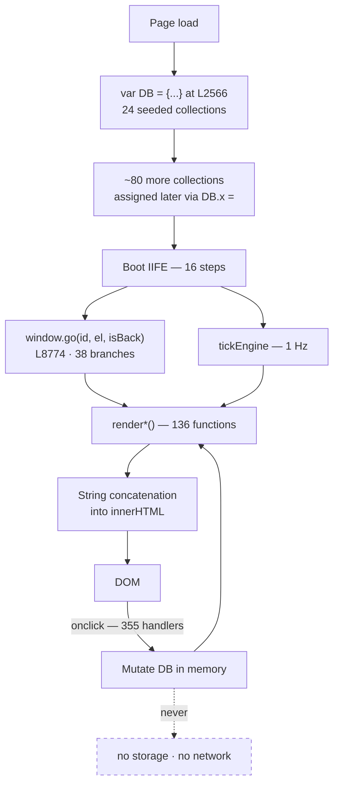

# Eyvar Ops Panel — System Overview

The front door to this documentation set. If you read one file, read this one.

---

## 1. What this is

Eyvar is a ride-subscription business operating in Saudi Arabia. Riders buy a
recurring plan — weekly, bi-weekly or monthly — that entitles them to a fixed
number of executed trips over a fixed window. Drivers, called *captains*, are
assigned to those recurring trips and are expected to hold a commitment to them.
This is materially different from on-demand ride-hailing: the product is a
promise about *tomorrow's* trip, so the operational job is less about matching
supply to demand in the moment and more about protecting a schedule that was
sold in advance. The panel also handles one-off "quick rides" alongside the
subscription business.

`eyvar_ops_panel_v40_fixed.html` is the internal operations panel for that
business — a single 21,857-line HTML file covering 41 screens: executive
reporting, live dispatch, subscription and renewal management, driver onboarding
and compliance, rider and driver wallets, support ticketing, fraud signals,
pricing configuration, and system administration.

---

## 2. The single most important fact

The file contains **no persistence and no network layer of any kind**:

| API | Occurrences |
|---|---|
| `localStorage` | 0 |
| `sessionStorage` | 0 |
| `indexedDB` | 0 |
| `fetch()` | 0 |
| `XMLHttpRequest` | 0 |

Every state change — approving a driver, paying a wallet, suspending an account,
settling a subscription — mutates the in-memory `DB` object and is destroyed on
page reload. Nothing is ever transmitted anywhere.

This should shape how the rest of this documentation is read. The panel is a
**high-fidelity specification of intent**, not a running back office. That is not
a criticism: the specification is unusually precise. Settlement mathematics,
commission structures, SLA ladders, permission matrices and a double-entry ledger
are all worked out in concrete, executable detail — far past what a wireframe or
a PRD would carry. Read it as the most complete statement available of how this
business intends to operate.

It also means one whole class of finding in these documents — "this action
doesn't persist", "this record can't be created", "this write is never read" —
should be weighed against that context rather than treated as ordinary bugs. The
defects that matter are the ones that would still be defects *after* a backend is
attached, and §7 separates them out.

---

## 3. Architecture at a glance

| Property | Value |
|---|---|
| Source | one file, 21,857 lines, 1.58 MB |
| Layout | CSS `L9-468` · HTML body `L472-2165` · JS `L2166-21855` |
| Build step | none |
| Framework | none |
| Screens (`.page` divs) | 41 |
| Sidebar sections / nav items | 9 / 30 |
| Pages with no sidebar entry | 11 (drill-down views) |
| Settings sub-tabs | 21, in 3 groups |
| Declared functions | 1,039 (136 `render*`, 903 other) |
| Distinct click handlers | 355 (+35 other inline handlers) |
| Element ids | 605 |
| `DB.<key>` collections | 101 — 24 in the literal, ~80 assigned later |
| Modal openers | 99 |
| Gated actions | 88, across 4 different gating mechanisms |
| `toast()` calls | 349 |
| Design tokens / CSS classes | 26 / 219 |
| i18n keys | 86 |

**How it works.** One global object literal, `var DB = {…}` at `L2566`, holds all
state. Screens are `
` elements that are all present in the DOM
at once; `window.go(id, el, isBack)` at `L8774` removes the `on` class from every
page, adds it to the target, and calls that page's render functions — 38
`if(id===…)` branches. Rendering is string concatenation assigned to `innerHTML`.

There is no component model, no virtual DOM and no reactivity: when data changes,
the code must remember to call the right `render*()` function. A substantial
group of the defects in §7 are cases where it doesn't.

---

## 4. The domain model in one page

Eight entities carry the business. Full detail in
[`03-data/DATA-MODEL.md`](../03-data/DATA-MODEL.md); relationships in
[`04-relations/ENTITY-RELATIONSHIPS.md`](../04-relations/ENTITY-RELATIONSHIPS.md).

| Entity | Collection | Seed | Role |
|---|---|---:|---|
| Rider | `DB.riders` | 10 | The customer. Buys plans, holds a wallet, accrues LTV and churn risk. |
| Driver / captain | `DB.drivers` | 6 | Supply. Tiered, rated, document-gated, holds a wallet and cash debt. |
| Subscription | `DB.subscriptions` | 7 | The product: a plan instance over a date window with an execution quota. |
| Trip | `DB.trips` | 8 | One executed journey — subscription trip or quick ride. |
| Plan | `DB.plans` | 3 | The catalogue: duration, quota, commission, per-km and per-minute rates. |
| Payment | `DB.payments` | 10 | Money in and out, including driver payouts. |
| Ticket | `DB.tickets` | 4 | Support conversation. |
| Team user | `DB.teamUsers` | 5 | Operators, with roles and permissions. |

The four load-bearing entities are `riders`, `drivers`, `subscriptions` and
`trips` — touched by **112, 112, 86 and 61 distinct functions** respectively.
They belong to no single screen, which is the central fact driving the
restructure proposal in [`05-restructure/`](../05-restructure/).

---

## 5. The nine functional areas

| Area | Pages | Purpose | Notable finding |
|---|---:|---|---|
| Executive | 1 | Trend and KPI reporting | Renders literal `NaN%` for average renewal rate (`L6931`) |
| Intelligence | 2 | Predictive signals, fraud | `DB.paymentRisk` is one hardcoded rider, never recomputed (`L14199`) |
| Overview | 3 | Dashboard, work inbox, live map | Leaflet loads render-blocking but is unused; the map is canvas |
| Operations | 7 | Subscriptions, trips, renewals, requests | `commitSettlement` moves no money while logging that it did |
| Fleet | 7 | Drivers, riders, compliance, safety | `d.docStatus` never assigned — two screens contradict each other |
| Growth | 2 | Promos, referrals, zones | No promo redemption engine; `spent`/`uses` never increment |
| Finance | 3 | Revenue, driver and rider wallets | `wallet_credit` idempotency key allows double-payment |
| Support | 2 | Tickets, driver contact | Complaints, disputes, incidents, lost items cannot be created |
| Config | 3 | Pricing, settings (21 tabs), audit | ~84% of audit action keys have no label and can't be filtered |

---

## 6. What works

The system is ambitious and much of it is carefully built. This deserves stating
plainly, because a findings list read alone gives a false impression.

- **The confirmation-gate registry.** 88 actions gated across four mechanisms,
  most carrying human-readable consequence copy. Someone thought hard about which
  operations deserve friction.
- **The double-entry ledger.** `DB.ledger` models 12 accounts and 8 entry types
  with idempotency keys — a sound design, and five real money paths post to it
  correctly.
- **The economics are real.** Settlement, commission, escrow, deduction, cash
  reconciliation, VAT-inclusive credit-note back-out, LTV and churn scoring are
  fully worked out. Verification Pass 2 re-derived **28 financial formulas from
  source and all 28 matched operator-for-operator**, including rounding order and
  clamp behaviour.
- **The 360° profile.** One shell resolves six entity types into a unified view —
  the strongest architectural idea in the file, and the reason the restructure
  keeps it as a cross-cutting surface.
- **The audit model.** `logAction(key, entityType, entityId, summary, before, after)`
  captures before/after diffs. The design is right even where coverage isn't.
- **Compliance document tracking.** The only surface computing document expiry
  correctly, with a per-driver minimum-rank rollup.
- **Honest self-documentation.** The `interventions` page states in its own body
  copy that it was superseded, and explains why — a rationale, not just dead code.

---

## 7. What doesn't — by pattern

Grouped by root cause, because patterns are actionable where 300 individual items
are not.

**(a) Values that are never computed.** `d.docStatus` is read in two places and
assigned nowhere, so Drivers reports `docsAtRisk: 0` while Compliance reports
`Expired: 1` for the same fleet. `#new-riders-count` is hardcoded `3` in markup
with no writer (`L911`). "New riders (48h)" applies no time filter.

**(b) Actions that silently do nothing.** `commitSettlement` (`L3684-3695`)
computes rider refund, driver payout and Eyvar's cut, writes all three into an
audit entry and a "payout queued" notification, and calls **zero** money
functions. `sendBulkMsg()` writes an audit row and a toast and sends nothing.
`reviewDriver()` and `sendDriverIncentive()` are stubs behind `danger`-styled
buttons.

**(c) Dead code and unused dependencies.** Leaflet CSS and JS load
render-blocking on every page view (`L469-470`) while `id="map-leaflet"` occurs
**0 times**. `renderDriverCircuit()` can never mount — its target appears once,
inside its own body. `getReferralCode()` appears once in 21,857 lines.
`renderOnCall()` targets an element that does not exist.

**(d) Contradictory sources of truth.** **Three live fare models plus two rate
tables that nothing consumes** — and editing a plan in the admin UI cannot change
what a subscription costs. Live reassign and cancel write `DB.liveTrips` but
never `DB.trips`, so the live board and the trips table diverge permanently.

> **Corrected after Verification Pass 2c.** An earlier revision of this document
> said "four disjoint pricing models with four different Economy per-km rates
> (1.20 / 1.10 / 1.10 / 1.35)". The four *values* are real and verified
> (`L21439`, `L13909`, `L2890`, `L18657`), but the framing was wrong: `DB.plans`
> is not a per-km fare model. Its `ecoKm` field has **zero pricing consumers** —
> its seven occurrences are the seed, form load/save, the new-plan template and
> audit snapshots. `perTripBaseRate` (`L4529-4534`) reads the frozen `PLANS`
> constant and returns `total ÷ exec`, a per-*trip* rate. Two of the remaining
> models also share a consumer in `computeDynamicSubPrice`.
>
> The accurate statement is **three live fare models and two unconsumed rate
> tables**, which is a *stronger* argument for consolidation than the original
> claim: a configuration surface that appears to set prices and in fact sets
> nothing is worse than a duplicated model.
>
> `docs/01-modules/14a-pricing-plans.md` §19 had the taxonomy right throughout;
> `16g` merged two models and the error propagated from there into this file,
> `04-relations/ENTITY-RELATIONSHIPS.md` (X10),
> `04-relations/MODULE-DEPENDENCY-MAP.md` and the restructure documents. Those
> are corrected separately — see `docs/02-verification/pass-2c-pricing-and-settings-audit.md` §5.

**(e) Gating and audit asymmetry.** `commitUserSwitch()` (`L3098`) has **no
permission check at all** — any operator becomes Owner, with no impersonation
banner and no way back. Rider wallet adjustment is gated behind `contact_users`
("Call/message riders & drivers"), so Support can move money and Finance cannot.
Approving a KYC document has no gate and no audit entry; rejecting one has both.
Of ~160 distinct `logAction` keys, only **26** have labels, leaving ~84% of the
audit trail unfilterable.

**(f) i18n that cannot be completed.** 86 keys against 605 element ids, and
**40 of 41 page bodies contain zero `data-i18n` attributes** — all content is JS
string concatenation into `innerHTML`, which the translation sweep cannot reach.
`applyLanguage` uses `textContent`, destroying inline markup. There is no `Intl`
usage; the currency and timezone settings are write-only.

**(g) Money-safety gaps.** `idemKey('wallet_credit', …, Math.floor(nowMs()/1000))`
at `L19980` folds a **one-second bucket** into the idempotency key, so a
double-click 1.1 s apart credits twice — while the `refund` key seventeen lines
earlier is correctly idempotent. `demoDoubleRefund()` issues a real SAR 25 refund
with no gate.

**(h) Entities that cannot be created.** `complaints`, `disputes`, `incidents` and
`lostFound` have 36 references between them and **zero** writes. Those screens can
only ever display seed rows.

---

## 8. Scale of the findings

**Method, so the number is checkable.** Each of the 60 module documents carries a
"Gaps, dead code, UNVERIFIED items" section and a "Hardcoded / mock / demo values"
section. Counting keyword occurrences across those documents —
`grep -ci 'BUG\|dead code\|never called\|never assigned\|no permission gate\|silently'` —
gives **313 hits**. That is an upper bound on distinct defects, not a count of
them: the same root cause is often reported by several documents.

The deduplicated register in
[`02-verification/FINDINGS-REGISTER.md`](../02-verification/FINDINGS-REGISTER.md)
is the authoritative count. Order of magnitude: **~200 distinct findings**, of
which a single-digit number are critical — money, data loss, or access control.

The documents also carry **252 `UNVERIFIED` markers**: places where an analyst
declined to assert something they could not confirm. That number is a quality
signal, not a deficiency.

---

## 9. How to use this documentation

**Engineer picking up the code.** Start here, then
[`03-data/DATA-MODEL.md`](../03-data/DATA-MODEL.md) and
[`04-relations/COUPLING-ANALYSIS.md`](../04-relations/COUPLING-ANALYSIS.md). Read
the module doc for your area before touching it — each ends with a line-number
index. Check the findings register for known defects in that area first.

**Operator learning the tool.** Read §4 and §5 above, then the module docs for
your role's screens. Their Actions tables state what each button actually does —
including where it does nothing.

**Decision-maker choosing what to rebuild.** Read §2, §6 and §7 here, then
[`05-restructure/PROPOSED-STRUCTURE.md`](../05-restructure/PROPOSED-STRUCTURE.md)
and [`05-restructure/MIGRATION-NOTES.md`](../05-restructure/MIGRATION-NOTES.md).
The critical findings are the ones to fix before anything is built on top.

---

## 10. Document map

| File | Answers |
|---|---|
| `README.md` | Where everything lives |
| `00-index/SYSTEM-OVERVIEW.md` | What the system is and what state it's in *(this file)* |
| `00-index/METHODOLOGY.md` | How the documentation was produced and verified |
| `00-index/GROUND-TRUTH-INVENTORY.md` | The machine census, plus 7 recorded corrections to itself |
| `01-modules/*.md` (60) | One document per module: every value, action, input, formula, state |
| `02-verification/pass-1-coverage-review.md` | Is anything missing? — 99.0% of 2,470 symbols |
| `02-verification/pass-2-accuracy-review.md` | Is anything wrong? — 5,728 claims checked |
| `02-verification/pass-2b-supplementary-audit.md` | The 8 documents pass 2 could not reach |
| `02-verification/orchestrator-spot-checks.md` | ~30 claims independently re-verified by the orchestrator |
| `02-verification/corrections-applied.md` | What was fixed, and which review findings were rejected |
| `02-verification/FINDINGS-REGISTER.md` | Every defect, deduplicated and prioritised by severity |
| `03-data/DATA-MODEL.md` | All 101 collections: fields, enumerations, foreign keys |
| `03-data/GLOBAL-STATE.md` | The 149 non-`DB` globals |
| `03-data/*.json` | Machine-readable inventory, findings, entities, action catalog |
| `04-relations/ENTITY-RELATIONSHIPS.md` | How the entities connect |
| `04-relations/MODULE-DEPENDENCY-MAP.md` | Which modules share which collections, and where they collide |
| `04-relations/DATA-FLOW.md` | End-to-end lifecycles, and where each chain breaks |
| `04-relations/COUPLING-ANALYSIS.md` | What the current structure gets wrong |
| `04-relations/data/` | The raw machine-extracted datasets behind the above |
| `05-restructure/PROPOSED-STRUCTURE.md` | The 5-tab information architecture |
| `05-restructure/PAGE-TRACEABILITY-MATRIX.md` | Proof all 41 pages are accounted for |
| `05-restructure/MIGRATION-NOTES.md` | Build sequence, and what must not be carried forward |

---

## 11. Limits of this analysis

- **Static analysis only.** The panel was read, not executed. Runtime-only
  behaviour is inferred, and marked `UNVERIFIED` where inference was required.
- **Seed data is fiction.** The formulas are real; the numbers are demo values.
- **Citations are pinned to this file version.** Any edit invalidates line
  numbers — re-run the census in `METHODOLOGY.md` afterwards.
- **Citation drift exists.** Pass 2 found ~99 stale line numbers, concentrated in
  citations pointing into the interior of long HTML template strings. Function,
  constant and seed-literal citations are reliably exact.
