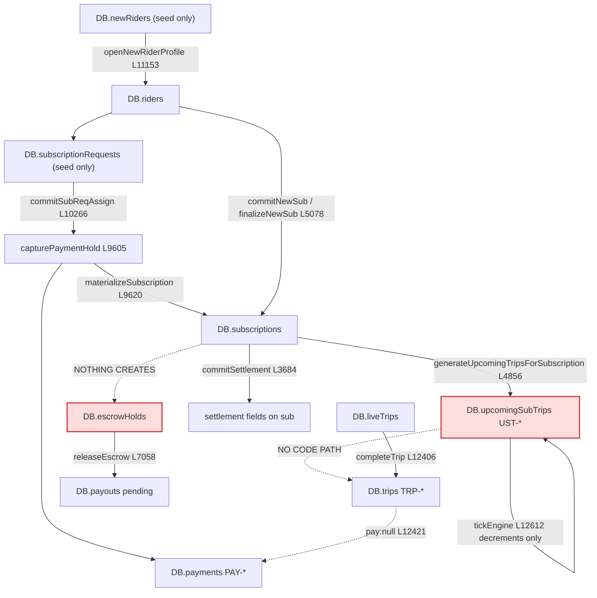
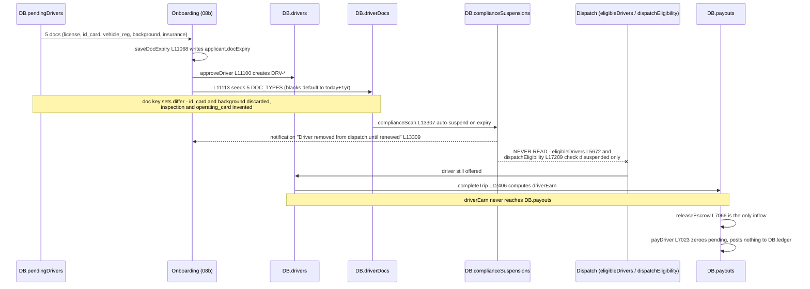
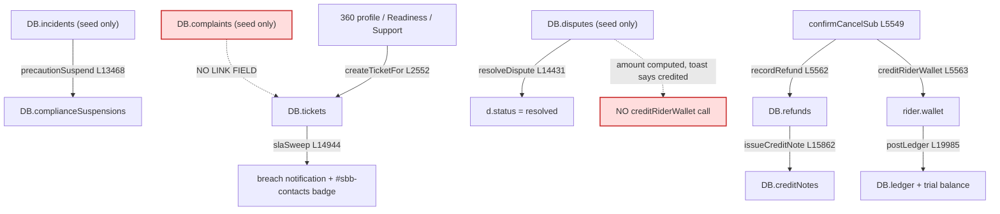
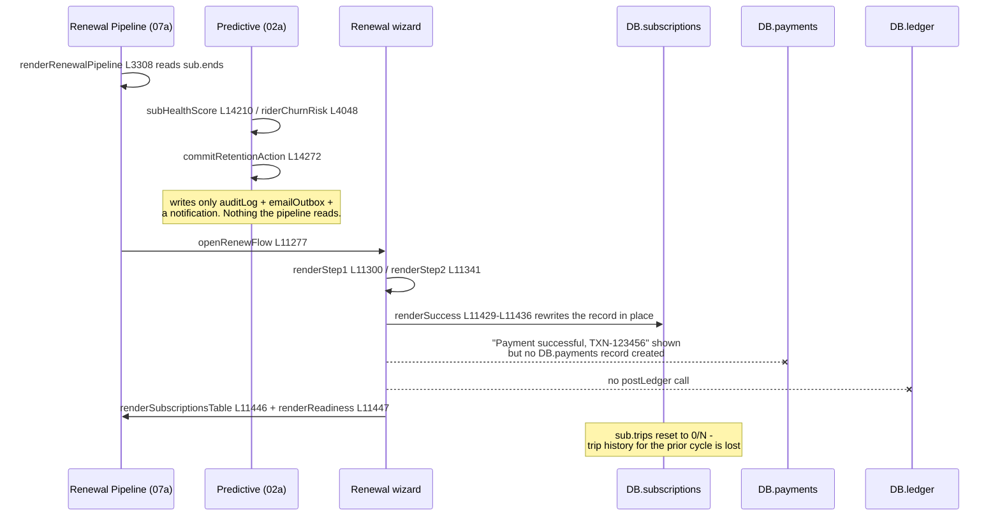

# Data Flow — the four principal lifecycles, end to end

> **Source:** `eyvar_ops_panel_v40_fixed.html`. Every step names the function and the line.
> **Breakpoint** = a step that is unimplemented, mocked, writes to a collection nobody reads, or
> announces a state change it does not perform. Each breakpoint below was verified by reading the
> function, not inferred from the module docs.

---

## Flow 1 — Rider signup → subscription → trip → payment → settlement

### 1.1 The chain, step by step

| # | Step | Function | Line | Writes | Reads |
|---|---|---|---|---|---|
| 1 | Rider signs up | *(seeded only)* `DB.newRiders` | `L2745` | — | — |
| 2 | Ops opens the new rider | `openNewRiderProfile` | `L11153` | **creates** `DB.riders[id]` | `DB.newRiders` |
| 3 | Welcome offer | `welcomeRider` → `confirmWelcomeOffer` | `L11160`, `L11176` | `rider.wallet` (only for `cash10`, hardcoded `10`, `L11184`), `DB.emailOutbox` | — |
| 4a | **Path A** — rider requests a subscription in the app | *(seeded)* `DB.subscriptionRequests` | `L2794` | — | — |
| 5a | Ops assigns a driver | `commitSubReqAssign` | `L10266` | `sreq.status='assigned'` | `DB.drivers` |
| 6a | Payment authorisation captured | `capturePaymentHold` | `L9605` | **`DB.payments[PAY-…]`** | `DB.riders` |
| 7a | Subscription materialised | `materializeSubscription` | `L9620` | `DB.subscriptions[SUB-…]`, `rider.subs[]`, `sreq.assignedSub` | `PLANS` `L4389`, `CADENCE_DAYS` `L11231` |
| 8a | Today's legs generated | `generateUpcomingTripsForSubscription` → `pushLeg` | `L4856`, `L4863` | `DB.upcomingSubTrips` (`UST-…`) | `sub.days`, `sub.departTime` |
| 4b | **Path B** — ops builds a subscription by hand | `commitNewSub` → `finalizeNewSub` | `L4913`, `L5078` | `DB.subscriptions`, `rider.subs[]`, `drv.notifLog` | `PLANS`, `computeDynamicSubPrice`, `findCorpForRider` |
| 5b | Corporate approval hold (if over threshold) | inside `finalizeNewSub` | `L5096`–`L5112` | `sub.pendingManagerApproval`, `DB.emailOutbox` | `getCorpUsagePolicy` |
| 6b | Start evaluation | `evaluateSubStart` | `L4743` | `sub.startOutcome`, driver fields | `DB.drivers` |
| 9 | A leg comes due | `tickEngine` | `L12612` | `ust.minutesUntil--` | `DB.upcomingSubTrips` |
| 10 | Readiness intervention | `logCallOutcome` / `logDriverCall` / `confirmPostponeTrip` | `L8536`, `L8559`, `L8634` | `ust.riderConfirmed`, `ust.driverStatus`, `sub.postponements` | |
| 11 | Trip completes | `completeTrip` | `L12406` | splices `DB.liveTrips`; `DB.trips[id].status='Done'`; ratings; `sub.trips` counter `L12458`–`L12461` | `DB.subscriptions`, `DB.drivers`, `DB.riders` |
| 12 | Settlement | `openSettlement` → `commitSettlement` | `L3639`, `L3684` | `sub.status`, settlement fields | `subEconomics` `L3605` |

### 1.2 Diagram

### 1.3 Breakpoints

| # | Step | What breaks | Evidence |
|---|---|---|---|
| B1.1 | Signup | Nothing creates a rider. `DB.newRiders` (`L2745`) has three frozen rows and no writer | §4.3 of `ENTITY-RELATIONSHIPS.md` |
| B1.2 | Promotion | `openNewRiderProfile` copies a new rider into `DB.riders` but **never removes the `newRiders` row** — the same person is then counted twice (`L6917` vs `L7669`) | `L11153`–`L11157` |
| B1.3 | Subscription request | Nothing creates an `SREQ-`. The five seeded rows are the entire supply | `L2794` |
| B1.4 | Path A vs Path B | The two creators produce different record shapes. `materializeSubscription` hardcodes `days:['Sun','Mon','Tue','Wed','Thu']` and omits `perTripFare`/`direction`; `finalizeNewSub` sets them but **creates no payment** | `L9633` vs `L5097`–`L5101` |
| B1.5 | Pricing | Both paths price from the frozen constant `PLANS` (`L4389`), not from `DB.plans` (`L2889`) which the Plan Editor writes. Editing a plan price changes nothing | `L5085`, `L9623`, `L11425` |
| B1.6 | **Escrow never created** | The subscription escrow model is the platform's stated protection (`L972`: *"Subscription payments are held in escrow"*). `DB.escrowHolds` has 4 seeded rows and **no creator** — the only writer, `releaseEscrow` (`L7064`), removes rows | `L2801`, `L7058` |
| B1.7 | **Legs never become trips** | `tickEngine` decrements `t.minutesUntil` while `>0` and nothing else (`L12612`). No function converts a `UST-` into a `TRP-` or a `liveTrips` row. Legs freeze at zero minutes | `L12612` |
| B1.8 | **Quick-ride trip has no payment** | `completeTrip` materialises a missing trip record with `pay:null` (`L12421`) and never creates a `DB.payments` row. Only two functions in the file create payments — `capturePaymentHold` (`L9611`) and `buildRiderHistory` (`L18766`) — and neither runs on trip completion | `L12421` |
| B1.9 | **Earnings never accrue** | `completeTrip` computes `driverEarn` into the trip record but never touches `DB.payouts`. The only line anywhere that *increases* `payouts.pending` is `releaseEscrow` `L7066` — and escrow is never created (B1.6). Driver earnings are permanently the seeded numbers | `L7030`, `L7053`, `L7066`, `L7079` are the only four `.pending` assignments |
| B1.10 | Back-references not maintained | `completeTrip` writes `trip.rider`/`trip.driver` but never appends to `rider.trips[]` or `driver.trips[]`, which the 360° profile reads | `L12406`–`L12474` vs `L2594`, `L2632` |
| B1.11 | Settlement | `commitSettlement` computes from `subEconomics` (`L3605`), which uses the hardcoded `EYVAR_COMMISSION_PCT = 20` (`L3604`) — not `DB.opsConfig.pricing.driverCommissionPct = 80` (`L2573`), not `DB.plans[*].eyvarPct` | `L3604` vs `L2573` |

---

## Flow 2 — Driver application → verification → approval → dispatch → earnings → payout

### 2.1 The chain

| # | Step | Function | Line | Writes |
|---|---|---|---|---|
| 1 | Application arrives | *(seeded)* `DB.pendingDrivers` | `L2712` | — |
| 2 | Ops reviews the 5 application docs | `renderAllPending` / `openApplicantDetail` | `L10939`, `L10855` | — |
| 3 | Reject a single document | `setDocStatus` / `confirmDocReject` | `L11034`, `L10879` | `applicant.docs[key]` |
| 4 | Capture expiry dates | `openDocDateEditor` → `saveDocExpiry` | `L11050`, `L11068` | `applicant.docExpiry` |
| 5 | **Approve** | `approveDriver` | `L11094` | `DB.drivers[DRV-…]` (`L11100`), `DB.driverDocs[DRV-…]` for all 5 `DOC_TYPES` (`L11113`), `applicant.approvedAs` (`L11114`), `DB.emailOutbox` (`L11115`) |
| 6 | Documents age | `complianceScan` (every 60 ticks, `L12615`) | `L13296` | `DB.complianceSuspensions[driverId] = 'Expired: …'` (`L13307`) |
| 7 | Precautionary suspension from an incident | `precautionSuspend` | `L13468` | `DB.complianceSuspensions[driverId] = 'Precautionary — pending INC-… investigation'` |
| 8a | Dispatch — subscription builder | `eligibleDrivers` | `L5672` | reads `d.suspended`, `driverAutoRestricted`, `driverTrustedForSubs`, `capacityOpen`, `hasOpenComplaint`, `driverCanTakeAnotherSub` |
| 8b | Dispatch — backup / emergency | `dispatchEligibility` | `L17209` | reads `d.suspended`, `d.planAccess`, `d.planFreezeUntilMs`, vehicle class, leg conflict |
| 8c | Dispatch — instant ride offer | `nextOfferCandidate` | `L12496` | |
| 9 | Trip completes | `completeTrip` | `L12406` | `trip.driverEarn` |
| 10 | Cash reconciliation | `maybeGenerateCashEvent` | `L12101` | `DB.cashLedger`, `DB.driverCashDebt` |
| 11 | Escrow release | `releaseEscrow` | `L7058` | `payouts.pending += e.amount` |
| 12 | Deduction | `confirmApplyDeduction` | `L7072` | `payouts.pending -= d.amount` (clamped at 0) |
| 13 | Payout | `executePayout` → `payDriver` | `L8716`, `L7023` | `payouts.paidOut`, `payouts.pending = 0`, `d.notifLog` |

### 2.2 Diagram

### 2.3 Breakpoints

| # | Step | What breaks | Evidence |
|---|---|---|---|
| B2.1 | Application intake | Nothing creates an `APP-`. Five seeded rows only | `L2712` |
| B2.2 | Document type mismatch | Applicant `docs` keys = `{license, id_card, vehicle_reg, background, insurance}` (`L2717`); `DOC_TYPES` = `[license, vehicle_reg, inspection, insurance, operating_card]` (`L13277`). `id_card` and `background` are verified then thrown away; `inspection` and `operating_card` are never verified but tracked forever, defaulting to **today + 1 year** when blank | `L2717` vs `L13277`, `L11110`–`L11113` |
| B2.3 | Applicant → driver link | `applicant.approvedAs` is written; the driver record has **no** back-pointer (every key on `L11100` enumerated) | `L11100`, `L11114` |
| B2.4 | Approver identity | `approveDriver` hardcodes `a.decidedBy='Sarah Al-Rashid'` (`L11114`) instead of calling `currentUserName()` (`L9651`) — the same value the audit entry gets correctly from `logAction` | `L11114` |
| B2.5 | **Auto-suspension does not suspend** | `complianceScan` writes `DB.complianceSuspensions[d]` and pushes a notification reading *"Driver removed from dispatch until renewed"* (`L13309`). All 5 readers of that store are `renderCompliancePage` (`L13348`), Safety KPI 4 (`L13404`), `steerableDrivers` (`L13987`), `subHealthScore` (`L14228`), `driverRiskScore` (`L14293`). **Neither `eligibleDrivers` (`L5672`) nor `dispatchEligibility` (`L17209`) reads it** — they test `d.suspended`, which `complianceScan` never sets. A driver with an expired licence is still offered for new subscriptions and backup dispatch | `L13296`–`L13315` vs `L5678`, `L17213` |
| B2.6 | Drivers page blindness | The Drivers page filters on `d.docStatus` — a field with **no writer anywhere** (`L6380`, `L20925`). It never reads `DB.driverDocs` | `MODULE-DEPENDENCY-MAP.md` §4.2 |
| B2.7 | Earnings | See B1.9 — trip completion never credits `DB.payouts` | |
| B2.8 | Escrow | See B1.6 — the only inflow into `payouts.pending` depends on a collection nothing creates | |
| B2.9 | Deduction shortfall | `p.pending = Math.max(0, p.pending - d.amount)` (`L7079`) — if the penalty exceeds the balance the remainder is discarded rather than carried | `L7079` |
| B2.10 | **Payout is off-ledger** | `payDriver`, `confirmProcessAll`, `releaseEscrow`, `confirmApplyDeduction` post nothing to `DB.ledger`. The trial balance cannot include driver money | `L7023`–`L7081`; the 7 `postLedger` sites are `L19969`, `L19985`, `L19997`, `L20014`, `L20018`, `L20040`, `L20045` |
| B2.11 | Bank transfer | `executePayout` renders a spinner, waits `1100 ms` and shows "Submitted via SARIE bank network" (`L8730`–`L8741`). Pure UI theatre — the file has no `fetch`/`XMLHttpRequest` | `L8716`–`L8748` |

---

## Flow 3 — Incident/complaint → ticket → dispute → refund/credit → wallet → ledger

### 3.1 The chain

| # | Step | Function | Line | Writes |
|---|---|---|---|---|
| 1a | Safety incident | *(seeded)* `DB.incidents` | `L13389` | — |
| 1b | Complaint | *(seeded)* `DB.complaints` | `L2706` | — |
| 2 | Incident worked through 4 steps | `renderSafetyPage` step toggles | `L13397` | `inc.steps.*` |
| 3 | Precautionary suspension | `precautionSuspend` | `L13468` | `DB.complianceSuspensions` |
| 4 | Incident closed | `closeIncident` | `L13475` | `inc.status='closed'` |
| 5 | Ticket raised | `createTicket` (Support), `createTicketFor` (`L2552`, 360° profile), `createReadinessTicket` (`L8690`, Readiness) | | `DB.tickets` |
| 6 | SLA stamped | `slaStampNewTicket`, `slaSweep` | `L14944`± | `t.slaFirstMs`, breach notifications |
| 7 | Agent replies / closes | `sendTicketReply`, `setTicketStatus`, `closeConversation` | | `t.thread[]`, `t.status`, `DB.emailOutbox` (`csat`) |
| 8 | Dispute filed | *(seeded)* `DB.disputes` | `L14391` | — |
| 9 | **Dispute resolved** | `resolveDispute` | `L14431` | `d.status='resolved'`, `d.outcome` |
| 10 | Refund recorded | `recordRefund` | `L3176` | `DB.refunds`, then `issueCreditNote` (`L15862`) → `DB.creditNotes`, `DB.creditNoteSequence` |
| 11 | Wallet credited | `creditRiderWallet` | `L3932` | `rider.wallet.balance`, `rider.wallet.transactions[]`, `DB.emailOutbox` |
| 12 | Ledger posted | `postLedger` via the wallet wrappers | `L19985` | `DB.ledger`, `DB.idempotency`, `DB.moneyRejects` on imbalance |

### 3.2 Diagram

### 3.3 Breakpoints

| # | Step | What breaks | Evidence |
|---|---|---|---|
| B3.1 | Complaint intake | Nothing creates a `CMP-`. `resolveComplaint` (`L4379`) only flips `status` | `L2706`, `L4379` |
| B3.2 | **Complaint → ticket** | No link field exists in either direction. `createTicketFor(entityId, entityName)` takes only the actor. A complaint and the ticket about it are unrelated records | `L2552`, `L2764` |
| B3.3 | Incident → suspension traceability | `precautionSuspend` embeds the incident id inside a display string (`'Precautionary — pending INC-014 investigation'`, `L13468`). Safety KPI 4 recovers only a count via `/Precautionary/` (`L13404`); nothing parses the id back out. An appeal against a precautionary suspension has no path back to its incident | `L13468`, `L13404` |
| B3.4 | **Dispute → money** | `resolveDispute` (`L14431`–`L14444`) computes `amount = perTrip` (refund) or `perTrip * 0.5` (goodwill), writes it into the toast *and* the audit summary (`'… — 86.50 SAR credited to Sara Al-Ghamdi'`), then calls neither `creditRiderWallet` nor `recordRefund`. Its gate (`L17857`–`L17872`) is confirmation-only. **The money is announced and never moves** | `L14437`–`L14443` |
| B3.5 | Dispute intake | Nothing creates a `DSP-`; two seeded rows | `L14391` |
| B3.6 | Double-record on cancellation | `confirmCancelSub` calls `recordRefund` (`L5562`) **and** `creditRiderWallet` (`L5563`) for the same money — one lands in `DB.refunds` + a credit note, the other in the wallet + `DB.ledger`. Finance and the ledger will both count it | `L5562`–`L5563`; `12c-rider-wallets.md` §15.3 |
| B3.7 | Ticket agent | `ticket.agent` is a display name, not `USR-` (`L2764`). `slaSweep` and the work inbox route by that string | `L2764` |
| B3.8 | Goodwill | `logGoodwill` (`L15436`) and `creditRiderWallet` are called back to back in `acceptEmergency` (`L17337`–`L17339`) — a second parallel record of one movement | `L17337` |
| B3.9 | Dead alert config | `DB.opsConfig.notifications.smsAlerts` and `.notifyOnDispute` are set and restored but never read anywhere; `emailAlerts` gates an **in-panel** notification, not email (`L12452`) | `03c-notifications.md` §15 |

---

## Flow 4 — Subscription renewal → retention action → churn or renewal

### 4.1 The chain

| # | Step | Function | Line | Writes |
|---|---|---|---|---|
| 1 | Expiry detected | `renderRenewalPipeline` | `L3308` | — (reads `sub.ends`, `sub.status`) |
| 2 | Churn risk scored | `riderChurnRisk` (`L4048`), `subHealthScore` (`L14210`) | | — |
| 3 | Watchlist rendered | `renderRetentionWatchlist` | `L6980` | — |
| 4 | **Proactive retention** | `openRetentionAction` → `commitRetentionAction` | `L14272` | `DB.auditLog`, `DB.emailOutbox`, an ops notification |
| 5 | Renewal wizard opened | `openRenewFlow` → `renderStep1` / `renderStep2` | `L11277`, `L11300`, `L11341` | flow-local vars |
| 6 | Approval hold (corporate) | `renderRenewalApprovalHold` | `L11394` | |
| 7 | **Renewal committed** | `renderSuccess` | `L11418` | `sub.plan`, `sub.started`, `sub.ends`, `sub.trips='0/N'`, `sub.paid`, `sub.status='Active'` — or creates a new `SUB-` with `Object.keys(DB.drivers)[0]` as driver (`L11442`) |
| 8 | Downstream refresh | `renderSubscriptionsTable()`, `renderReadiness()` | `L11446`, `L11447` | — |
| 9 | Churn path | `confirmCancelSub` | `L5549` | `sub.status`, `recordRefund`, `creditRiderWallet` |
| 10 | Auto-renew toggle | `toggleAutoRenew` / `commitAutoRenewOff` | `L5442` | `sub.autoRenew` |

### 4.2 Diagram

### 4.3 Breakpoints

| # | Step | What breaks | Evidence |
|---|---|---|---|
| B4.1 | **Retention action is a no-op** | `commitRetentionAction` (`L14272`–`L14282`) logs an audit line, sends an email for `kind==='offer'`, toasts, and pushes a notification. It writes **no field on the subscription and nothing the Renewal Pipeline reads**. The action can never be seen again except as an audit row | `L14272`–`L14282` |
| B4.2 | **Renewal takes no payment** | `renderSuccess` generates `txn = 'TXN-' + random` (`L11423`), renders *"Payment successful · N SAR charged"* (`L11453`–`L11457`) and discards the id. No `DB.payments` row, no `DB.ledger` posting, no invoice | `L11418`–`L11462` |
| B4.3 | Trip history erased on renewal | `sub.trips = '0/' + plan.exec` (`L11436`) overwrites the counter in place. The prior cycle's delivery record is gone; `DB.trips` rows still point at the same `SUB-` id, so the subscription profile's trip log now shows trips from a cycle the counter says never happened | `L11436` vs `L4294` |
| B4.4 | Arbitrary driver on fallback | If the rider has no current subscription, `renderSuccess` creates one with `fallbackDrv = Object.keys(DB.drivers)[0]` — the first key in the object, currently `DRV-0101` — with no eligibility, capacity, gender-preference or vehicle-class check | `L11442`–`L11443` |
| B4.5 | Renewal prices from the frozen table | `plan = PLANS[o.cadenceKey]` (`L11425`) — the Plan Editor's `DB.plans` is not consulted | `L11425`, `L4389` |
| B4.6 | Churn path double-records | See B3.6 | `L5562`–`L5563` |
| B4.7 | Reverse reference left dangling | `confirmCancelSub` never removes the id from `rider.subs[]`; the rider profile keeps listing the cancelled subscription as theirs | `L5549`, `L2594` |
| B4.8 | `autoRenew` never renews | Written by `toggleAutoRenew` (`L5450`) and `commitAutoRenewOff` (`L5472`). It **is** read — but only as a display/priority signal: renewal-pipeline sorting and the "manual required" filter (`L3327`, `L3337`, `L3342`, `L3360`, `L21123`), `riderChurnRisk` (`L4052`), the subscriptions-table toggle (`L3552`), the sub profile (`L4339`), and the renewal-repair card (`L20609`). **No scheduler, tick handler or renewal function acts on it** — `tickEngine` (`L12508`) has no renewal branch, so an `autoRenew:true` subscription still requires a human to walk the wizard | `L5450`, `L3327`, `L12508` |

---

## 5. Breakpoint summary

**32 verified breakpoints** across the four flows.

| Category | Count | Examples |
|---|---|---|
| **Collection with no creator** (entity cannot come into existence) | 7 | `newRiders`, `subscriptionRequests`, `pendingDrivers`, `escrowHolds`, `deductions`, `complaints`, `disputes`, `incidents` |
| **Announced but not performed** (UI/audit claims a state change the code does not make) | 5 | B3.4 dispute credit · B4.2 renewal payment · B2.5 auto-suspension · B2.11 bank transfer · B4.1 retention action |
| **Chain terminates** (state produced that nothing acts on) | 4 | B1.7 legs never become trips · B1.9 earnings never accrue · B2.10 payouts off-ledger · B4.8 `autoRenew` read but never acted on |
| **Dual representation diverges** | 5 | live vs recorded trip · applicant vs driver docs · `docStatus` vs `driverDocs` · refund vs wallet credit · two subscription creators |
| **Reference not maintained** | 4 | `rider.trips[]`, `driver.trips[]`, `rider.payments[]`, `rider.subs[]` on cancel |
| **Wrong constant / frozen source** | 4 | `PLANS` vs `DB.plans` (×3 call sites) · `EYVAR_COMMISSION_PCT` vs `opsConfig.pricing` |
| **Identity hardcoded** | 3 | `decidedBy:'Sarah Al-Rashid'` (×2 in `approveDriver`/`rejectDriver`), `processedBy` on seeded refunds |

The distribution is the finding: **the failures cluster at module boundaries, not inside modules.**
Every module's own screen is internally coherent — the Live board correctly reassigns a live trip, the
Renewal wizard correctly renews a subscription, Compliance correctly detects an expired licence. What
is missing, in every case, is the write into the *neighbouring* module's store.
