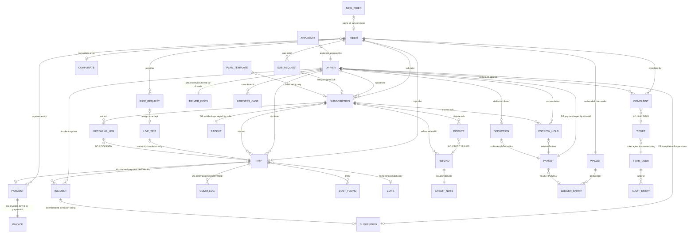

# Entity Relationships — the domain model as it actually exists

> **Source:** `eyvar_ops_panel_v40_fixed.html` (21,857 lines). Every `L####` is a line in that file.
> **Doc-derived claims** cite the module doc filename under `docs/01-modules/`.
> **Method:** entity shapes read directly from the seed literals; every linking field re-read in the
> source rather than taken from the module docs. Where a doc and the source disagree, the source wins
> and the disagreement is noted.

---

## 0. What "entity" means here

There is no schema, no ORM, no persistence. `var DB={…}` (`L2566`) is a plain object literal; 80 more
collections are bolted on afterwards with `DB.x=` statements scattered from `L2863` to `L21464`. There
are **zero** occurrences of `localStorage`, `sessionStorage`, `indexedDB`, `fetch(` or `XMLHttpRequest`
in the file — every relationship below lives in RAM and dies on reload.

**101 distinct `DB.<key>` collections are referenced; all 101 are defined.** **21** sit inside the
literal and **80** are late-assigned. (`collections-in-literal.txt` lists 24 — three of its entries,
`weekly` / `biweekly` / `monthly`, are the nested cadence keys of `DB.plans`, not top-level
collections; 21 + 80 = 101 exactly.) Of those 101,
**34 carry a business entity with its own id**; the rest are
config blobs, logs, indexes or lookup maps.

Two structural shapes coexist and the choice is not principled:

| Shape | Access pattern | Examples |
|---|---|---|
| **Keyed map** `{'ID':{…}}` | `DB.x[id]` — O(1), id is authoritative | `riders`, `drivers`, `trips`, `subscriptions`, `payments`, `complaints`, `corporateAccounts`, `payouts`, `driverDocs`, `invoices`, `creditNotes` |
| **Array** `[{id:'…'}]` | `.find(x=>x.id===id)` — O(n), id is a field | `tickets`, `disputes`, `incidents`, `lostFound`, `escrowHolds`, `deductions`, `refunds`, `liveTrips`, `rideRequests`, `subscriptionRequests`, `upcomingSubTrips`, `pendingDrivers`, `newRiders`, `teamUsers`, `zones`, `promos`, `auditLog` |

`teamUsers` is an array searched by `.find` on every permission check (`currentUserName` `L9651`)
while `riders`/`drivers` are maps — the same "look up an actor by id" operation is written two
different ways depending on which collection you land in.

---

## 1. Core entity census

| # | Entity | Collection | Shape | Id prefix | Defined | Represents |
|---|---|---|---|---|---|---|
| 1 | Rider | `DB.riders` | map | `RDR-` | `L2593` | A passenger account: profile, wallet, device/IP, `subs[]`/`trips[]`/`payments[]`/`complaints[]` back-references, `stats` |
| 2 | New rider (48h) | `DB.newRiders` | array | `RDR-3###` | `L2744` | Sign-ups not yet promoted into `DB.riders`. **Same id prefix as riders** |
| 3 | Driver | `DB.drivers` | map | `DRV-` | `L2631` | An approved captain: vehicle, rating, `bank`, `notifLog`, `trips[]`, `stats` |
| 4 | Applicant | `DB.pendingDrivers` | array | `APP-` | `L2712` | A driver application awaiting approve/reject, with a 5-key `docs` object |
| 5 | Trip (record) | `DB.trips` | map | `TRP-` | `L2670` | The historical trip record — fare, km, status, `pay` |
| 6 | Live trip | `DB.liveTrips` | array | `TRP-` (same ids) | `L2781` | An in-flight trip: `stage`, `eta`, `driver` |
| 7 | Upcoming sub trip (leg) | `DB.upcomingSubTrips` | array | `UST-` | `L6177` | A scheduled subscription leg for today |
| 8 | Ride request | `DB.rideRequests` | array | `REQ-` | `L2786` | An unmatched on-demand request |
| 9 | Subscription request | `DB.subscriptionRequests` | array | `SREQ-` | `L2794` | A rider asking for a subscription, before a driver exists |
| 10 | Subscription | `DB.subscriptions` | map | `SUB-` | `L2685` | The commercial contract: rider + driver + plan + window + trip counter |
| 11 | Plan (editable) | `DB.plans` | map | key `weekly`/`biweekly`/`monthly` | `L2889` | The admin-editable plan template |
| 12 | Payment | `DB.payments` | map | `PAY-` | `L2694` | A money-in record; `PAY-W###` rows are **driver payouts stored in the same map** |
| 13 | Refund | `DB.refunds` | array | `REF-` | `L2881` | A money-out record for a cancelled subscription |
| 14 | Credit note | `DB.creditNotes` | map | `CN-` | `L15847` | Sequential VAT credit note against an invoice |
| 15 | Invoice | `DB.invoices` | map keyed by **payment id** | `INV-` | `L13973` | One stable e-invoice per payment |
| 16 | Escrow hold | `DB.escrowHolds` | array | `ESC-` | `L2801` | Subscription money held until all trips are delivered |
| 17 | Deduction | `DB.deductions` | array | `DED-` | `L2807` | A penalty against a driver payout |
| 18 | Payout balance | `DB.payouts` | map keyed by **driver id** | *(no id field)* | `L2812` | Running `earned`/`paidOut`/`pending` per driver |
| 19 | Rider wallet | `rider.wallet` *(embedded)* | object | txns `WTX-` | `L2594` | Balance + transaction list, **inside the rider record** |
| 20 | Driver cash debt | `DB.driverCashDebt` | map keyed by driver id | *(none)* | `L12081` | Running cash owed by a driver |
| 21 | Cash ledger event | `DB.cashLedger` | array | `CASH-` | `L12080` | Expected-vs-reported cash per completed trip |
| 22 | Complaint | `DB.complaints` | map | `CMP-` | `L2706` | A rider complaint against a driver |
| 23 | Ticket | `DB.tickets` | array | `TKT-` | `L2763` | A support conversation with a `thread[]` |
| 24 | Dispute | `DB.disputes` | array | `DSP-` | `L14391` | A subscription-level money dispute with `evidence[]` |
| 25 | Lost & found | `DB.lostFound` | array | `LF-` | `L14448` | An item left in a vehicle |
| 26 | Incident | `DB.incidents` | array | `INC-` | `L13389` | Safety event with a 4-step `steps` workflow |
| 27 | Fairness case | `DB.fairnessCases` | array | `FC-` | `L15505` | A captain's contest of a rating / report / suspension |
| 28 | Corporate account | `DB.corporateAccounts` | map | `CORP-` | `L13846` | Employer account with `riders[]` and a `usagePolicy` |
| 29 | Team user | `DB.teamUsers` | array | `USR-` | `L2830` | The only identity store — role + `permissions[]` |
| 30 | Audit entry | `DB.auditLog` | array | `AUD-` | `L2863` | Actor + action + entity + before/after |
| 31 | Zone | `DB.zones` | array | **none — `name` only** | `L13952` | Demand / supply / failure counts for a Riyadh district |
| 32 | Promo | `DB.promos` | array | key = `code` | `L13495` | Discount campaign with budget / spend |
| 33 | Driver docs | `DB.driverDocs` | map keyed by driver id | *(none)* | `L13278` | 5 expiry dates per driver |
| 34 | Journal posting | `DB.ledger` | array | `JE-` | `L19879` | Double-entry posting produced by `postLedger` (`L19917`) |

---

## 2. Relationship inventory

Cardinality notation: `1—1`, `1—N`, `N—M`. "Linking field" is the field verified in the source that
carries the relationship; "Integrity" says what, if anything, enforces it.

### 2.1 Rider-centric

| # | Relationship | Card. | Linking field | Verified at | Integrity |
|---|---|---|---|---|---|
| R1 | Rider → Subscription | 1—N | `sub.rider` = `RDR-…` **and** `rider.subs[]` = `['SUB-…']` | `L2686`, `L2594` | **None — duplicated both ways.** `finalizeNewSub` writes both (`L5097`, `L5103`); `materializeSubscription` writes both (`L9626`, `L9636`); `renderSuccess` writes both (`L11443`, `L11444`) |
| R2 | Rider → Trip | 1—N | `trip.rider` **and** `rider.trips[]` | `L2671`, `L2594` | None. `completeTrip` sets the trip's `rider` but **never appends to `rider.trips[]`** (`L12406`–`L12474`) |
| R3 | Rider → Payment | 1—N | `payment.entity` = rider id **and** `rider.payments[]` | `L2695`, `L2594` | None. `capturePaymentHold` (`L9611`) writes `DB.payments[payId]` and never touches `rider.payments[]` |
| R4 | Rider → Complaint | 1—N (as filer) | `complaint.by` **and** `rider.complaints[]` | `L2707`, `L2594` | None; nothing creates complaints at runtime |
| R5 | Rider → Wallet | 1—1 **embedded** | `rider.wallet.{balance,transactions[]}` | `L2594` | Structural — but a rider seeded without `wallet` has none (`RDR-2031`, `L2603`) |
| R6 | Rider → Ride request | 1—N | `req.rider` | `L2787` | None |
| R7 | Rider → Subscription request | 1—N | `sreq.rider` | `L2795` | None |
| R8 | Rider → Corporate account | N—1 | `corp.riders[]` contains the rider id | `L13847` | Resolved by array scan: `findCorpForRider`, called at `L5094` and `L12424` |
| R9 | New rider → Rider | 1—1 lazy | Same id; `openNewRiderProfile` creates `DB.riders[id]` on first profile open | `L11153`–`L11157` | **None, and the `newRiders` row is never removed** — the person then exists in two registries at once |

### 2.2 Driver-centric

| # | Relationship | Card. | Linking field | Verified at | Integrity |
|---|---|---|---|---|---|
| D1 | Applicant → Driver | 1—1 | `applicant.approvedAs` = new `DRV-…` | `L11114` | **One-way.** Every key on the created driver literal (`L11100`) was enumerated: `name, phone, email, rating, lvl, vehicle, type, joined, dob, nid, address, city, gender, device, appLang, lastIp, ipLocation, hasPhoto, bank, movementLog, notifLog, trips, payments, complaints, stats, …` — there is **no** `applicationId` back-pointer |
| D2 | Driver → Trip | 1—N | `trip.driver` **and** `driver.trips[]` | `L2671`, `L2632` | None; `completeTrip` does not append to `driver.trips[]` |
| D3 | Driver → Subscription | 1—N | `sub.driver` | `L2686` | Capped only by advisory limits in `DB.opsLimits` — `driver_max_active_subs` is `enforced:false` (`L2590`) |
| D4 | Driver → Payout balance | 1—1 | `DB.payouts[driverId]` | `L2812` | `ensurePayoutEntry` (`L8894`) creates lazily; 3 of 6 seeded drivers have a row |
| D5 | Driver → Escrow hold | 1—N | `escrow.driver` | `L2802` | None; 4 seeded rows and **no runtime creator** (§4.3) |
| D6 | Driver → Deduction | 1—N | `deduction.driver` (+ `deduction.trip`) | `L2808` | None; 3 seeded rows, no runtime creator |
| D7 | Driver → Cash debt | 1—1 | `DB.driverCashDebt[driverId]` | `L12081` | `applyCashDebtImpact`, `commitCashRepayment` |
| D8 | Driver → Documents | 1—1 | `DB.driverDocs[driverId]` = 5 expiry dates | `L13278` | `approveDriver` seeds all five (`L11113`) |
| D9 | Driver → Compliance suspension | 1—0..1 | `DB.complianceSuspensions[driverId]` = reason **string** | `L13285` | Exactly two writers: `complianceScan` (`L13307`) and `precautionSuspend` (`L13468`) |
| D10 | Driver → Backup assignment | N—M | `DB.subBackups[subId]` = driverId | `L13140` | Aliased as `DB.backupRegistry` (`L17198`) — one object, two names |
| D11 | Driver → Circuit | 1—N | `DB.circuits[driverId]` = list of stops | `L2817` | **Frozen seed** — never written; stops reference riders by id with no trip id |
| D12 | Driver → Complaint | 1—N (as subject) | `complaint.against` | `L2707` | None |
| D13 | Driver → Bank account | 1—1 embedded | `driver.bank` + `driver.bankHistory[]` | `L2634`, `L2653` | Structural |

### 2.3 Trip / dispatch chain

| # | Relationship | Card. | Linking field | Verified at | Integrity |
|---|---|---|---|---|---|
| T1 | Subscription → Trip | 1—N | `trip.sub` = `SUB-…` | `L2671` | None. Trip counter `sub.trips` is a **string** `'5/5'` split, parsed and re-joined by `completeTrip` (`L12458`–`L12461`) |
| T2 | Subscription → Upcoming leg | 1—N | `ust.sub` | `L6180` | `generateUpcomingTripsForSubscription` (`L4856`) |
| T3 | Upcoming leg → Trip | **absent** | — | — | **No code path converts a `UST-` into a `TRP-`.** `tickEngine` only decrements `t.minutesUntil` while `> 0` (`L12612`), so legs pile up at zero forever |
| T4 | Ride request → Live trip | 1—1 | `commitRequestAssign` pushes into `DB.liveTrips` (`L11898`); `driverAcceptOffer` likewise (`L12483`) | `L11898`, `L12483` | The request is spliced out; the ids are unrelated (`REQ-` → `TRP-`) |
| T5 | Live trip → Trip | 1—1 by shared id | `completeTrip` looks up `DB.trips[t.id]` and creates it if absent | `L12406`–`L12424` | **Only on completion.** Reassign (`L11799`) and cancel (`L11834`) do not touch `DB.trips` |
| T6 | Subscription request → Subscription | 1—1 | `sreq.assignedSub` = new `SUB-…` | `L9635` | One-way; the subscription carries no `fromRequest` field |
| T7 | Trip → Payment | 1—1 | `trip.pay` = `PAY-…` **and** `payment.trip` | `L2671`, `L2695` | **Both directions exist and disagree in type** — see W1 |
| T8 | Trip → Comm log | 1—N | `DB.commLogs[tripId]` | `L2749` | Keyed map, no back-reference |
| T9 | Trip → Zone | derived only | `zoneOfAddress` / `zoneOfPickup` string-match the route text against `DB.zones[].name` | `L7263`–`L7282` | **No zone id exists at all** |
| T10 | Trip → Arrival trace | 1—0..1 | `DB.arrivalTraces[tripId]` | `L17611` | Written only by `seedArrivalTraces` |

### 2.4 Money chain

| # | Relationship | Card. | Linking field | Verified at | Integrity |
|---|---|---|---|---|---|
| M1 | Payment → Invoice | 1—1 | `DB.invoices[paymentId]` | `L13973`, `getOrCreateInvoice` `L4396` | Keyed directly by payment id — the strongest link in the file |
| M2 | Refund → Credit note | 1—1 | `issueCreditNote(entry)` (`L15862`) called from `recordRefund` | `L3176`–`L3201` | `cn.unlinked` flags a credit note with no findable invoice |
| M3 | Refund → Subscription | N—1 | `refund.relatedId` = `SUB-…` | `L2883` | Free-form string; `rowLink(relatedId)` resolves it against six collections (`L3283`) |
| M4 | Escrow → Payout | 1—1 | `releaseEscrow` splices the hold, then `p.pending += e.amount` | `L7058`–`L7069` | **The only inflow into `payouts.pending` anywhere in the file** (verified: the four `.pending` assignment sites are `L7030`, `L7053`, `L7066`, `L7079`) |
| M5 | Deduction → Payout | 1—1 | `confirmApplyDeduction` does `p.pending = Math.max(0, p.pending - d.amount)` | `L7072`–`L7081` | Clamped at 0 — any shortfall silently vanishes |
| M6 | Rider wallet → Ledger | 1—N | `creditRiderWallet` / `debitRiderWallet` wrappers post to `DB.ledger` | `L19985`, `L19997` | Wrapped in `withIdempotency` (`L19893`) |
| M7 | Driver payout → Ledger | **absent** | — | `L7023`–`L7081` | Only 7 `postLedger` call sites exist (`L19969`, `L19985`, `L19997`, `L20014`, `L20018`, `L20040`, `L20045`) and **none** is a driver payout |
| M8 | Goodwill credit → Ledger | 1—1 | `logGoodwill` (`L15436`) plus `creditRiderWallet` | `L17337`–`L17339` | Two records for one money movement |

### 2.5 Support / safety chain

| # | Relationship | Card. | Linking field | Verified at | Integrity |
|---|---|---|---|---|---|
| S1 | Ticket → Entity (rider or driver) | N—1 | `ticket.entity` + `ticket.entityName` | `L2764` | Polymorphic string, resolved by `resolveId` (`L3266`) |
| S2 | Complaint → Ticket | **absent** | — | — | **No field links them in either direction.** `createTicketFor(entityId, entityName)` (`L2552`) takes only the actor, never a complaint id |
| S3 | Dispute → Subscription | N—1 | `dispute.sub` | `L14392` | Used by `subEconomics(DB.subscriptions[d.sub])` (`L14400`) |
| S4 | Dispute → Refund / credit | **absent** | — | `L14431`–`L14444` | `resolveDispute` computes `amount` and announces *"… credited to <rider>"* in both the toast and the audit line — but calls neither `creditRiderWallet` nor `recordRefund`. Its gate (`L17857`) is confirmation-only |
| S5 | Incident → Driver | N—1 | `incident.against` | `L13390` | Feeds `driverRiskScore` (`L14294`) |
| S6 | Incident → Suspension | 1—1 | `precautionSuspend` writes `DB.complianceSuspensions[drv] = 'Precautionary — pending {INC-id} investigation'` | `L13468` | **The link lives inside a display string.** The only machine-readable trace is a `/Precautionary/` regex on Safety KPI 4 (`L13404`); the incident id is never parsed back out |
| S7 | Lost & found → Trip | N—1 | `lf.trip` + `lf.rider` + `lf.driver` | `L14449` | Triple-denormalised, nothing keeps the three consistent |
| S8 | Fairness case → Driver / subject | N—1 / N—1 | `c.driverId`, `c.subjectId`, `c.reasonCode` | `L15507`–`L15509` | The rider no-show counter re-reads this store (`riderNoShowCount` `L19525`) |
| S9 | Audit entry → Entity | N—1 | `entityType` + `entityId` | `L2864` | `resolveId` searches only six collections, so every `entityType:'team_user'` row renders as plain text (`00c-identity-permissions-and-audit.md` §7) |

### 2.6 Configuration → operation

| # | Relationship | Card. | Linking field | Verified at | Integrity |
|---|---|---|---|---|---|
| C1 | Plan (`DB.plans`) → Subscription | **partial** | `commissionRateForPlan` reads `DB.plans[x].eyvarPct`; `planKeyFromLabel` maps a label back to a key | usage matrix (`db-usage-matrix.tsv`) | **Price does not flow.** `finalizeNewSub` prices from the frozen `PLANS` constant (`L4389`), never from `DB.plans` |
| C2 | Plan constant `PLANS` → Subscription | 1—N | `sub.plan = plan.label + ' ' + vehicleType` — a **display string**, not a key | `L5097` | Reverse-resolved by `planKeyFromLabel` |
| C3 | Corporate policy → Subscription | 1—N | `sub.approvalCorp`, `sub.approvalThreshold`, `sub.pendingManagerApproval` | `L5101` | Copied at creation; a later policy edit never revisits held subscriptions |
| C4 | Reason code → Ticket / contact / fairness case | N—1 | `reasonCode` string | `L14667` | Free string with three independent producers |
| C5 | Zone → Steering offer | 1—0..1 | `DB.steerOffers[].zone` = zone **name** | `L13960`, `L14033` | Name-matched |

**Totals: 34 entities · 62 catalogued relationships** (R1–R9 = 9, D1–D13 = 13, T1–T10 = 10, M1–M8 = 8,
S1–S9 = 9, C1–C5 = 5, plus the 8 duplicate-encoding pairs X1–X10 counted in §4.2). Of the 62, **six
are absent-by-verification** (T3, M7, S2, S4, and the two halves of X5/X6) — the relationship exists
in the interface language and in the module docs, but no field or code path implements it.

---

## 3. ER diagram — core entities

---

## 4. Weak links

### 4.1 Relationships held together by a string with no integrity enforcement

Every relationship here is a bare string id. These are the ones where that actually bites:

| # | Weak link | Why it matters | Evidence |
|---|---|---|---|
| W1 | `payment.trip` holds a **`TRP-` id, or a `SUB-` id, or `'—'`** | Any join from payments to trips must guess the id space. `renderTripsTable` finds a payment by scanning `Object.keys(DB.payments)` for `p.trip === id` (`L3449`); a subscription-charge payment therefore matches the *subscription*, a quick-ride payment matches the *trip*. Two semantics in one field | `L2695` (`SUB-1041`) vs `L2698` (`TRP-7742`) vs `L2704` (`'—'`) |
| W2 | Driver payouts live inside `DB.payments` as `PAY-W###` | `PAY-W640` = `{entity:'DRV-0101', type:'Driver payout', trip:'—'}` in the same map as rider charges. Every revenue aggregation over `DB.payments` must filter it out by string — `contributionMargin` sums that map at `L15719` | `L2704` |
| W3 | `sub.plan` is a **display label**, not a key | `'Weekly Economy'`, `'Bi-weekly Comfort'`. `planKeyFromLabel` reverse-parses it. Renaming a plan in the Plan Editor orphans every existing subscription's plan lookup | `L2686`, `L5097` |
| W4 | `sub.trips` is the **string** `'5/5'` | `completeTrip` splits on `/`, parses both halves, increments and re-joins (`L12458`–`L12461`). Any non-conforming value becomes `NaN/NaN` silently | `L2686`, `L12458` |
| W5 | Zones have **no id** | `DB.zones` rows carry only `name`. Trips, steering offers and the recruitment queue all reference zones by display name through `zoneOfAddress` string matching | `L13952`, `L7263` |
| W6 | The incident→suspension link is **inside a reason string** | `'Precautionary — pending INC-014 investigation'`. Safety KPI 4 recovers only a *count* via `/Precautionary/`; a suspension can never be traced back to its incident programmatically | `L13468`, `L13404` |
| W7 | `ticket.agent` is a **person's name**, not `USR-` | `'Lina Al-Otaibi'`, or `'—'`. Renaming a team member breaks every historical ticket's assignment | `L2764` |
| W8 | Corporate membership is an **array scan** | `findCorpForRider` walks every account's `riders[]`. There is no `rider.corpId` | `L13847` |
| W9 | `DB.subBackups` is aliased as `DB.backupRegistry` | `DB.backupRegistry = DB.subBackups` (`L17198`) — one object, two names, ~13 read sites split between them. The comment at `L17189`–`L17196` records that a second, separate registry previously existed and the emergency dispatcher read only that one | `L17197`–`L17198` |
| W10 | `DB.newRiders` rows are never deleted | After `openNewRiderProfile` (`L11156`) the same person is in both registries. `renderExecOverview` counts `DB.newRiders.length` (`L6917`) while `renderExportCounts` counts `Object.keys(DB.riders).length` (`L7669`) — one person, two counts | `L11153`, `L6917` |

### 4.2 The same logical relationship encoded two different ways

Not a missing constraint — two live encodings that can, and do, disagree.

| # | Duplication | Encoding A | Encoding B | Divergence |
|---|---|---|---|---|
| X1 | **Rider ↔ subscription** | `sub.rider` (forward) | `rider.subs[]` (reverse array) | All three creators write both. Nothing writes the reverse on **cancellation** — `confirmCancelSub` (`L5549`) flips `sub.status` and leaves the id in `rider.subs[]` |
| X2 | **A trip in flight** | `DB.trips[id]` | `DB.liveTrips[]` row with the **same id** | `commitLiveReassign` (`L11794`–`L11802`) writes `t.driver` on the live row only; `confirmCancelLiveTrip` (`L11824`–`L11847`) splices the live row only. Verified: **neither function contains the token `DB.trips`**. `DB.trips['TRP-7741']` keeps `driver:'DRV-0101'`, `status:'In trip'` forever. Compare `completeTrip` (`L12406`), which *does* sync both |
| X3 | **A scheduled subscription trip** | `DB.upcomingSubTrips` (`UST-`) | `DB.trips` (`TRP-`) | No conversion (T3). Trip Readiness and All Trips describe disjoint universes |
| X4 | **A pending ride** | `DB.rideRequests` (`REQ-`) | `DB.subscriptionRequests` (`SREQ-`) | Two queues, two renderers (`renderRequestsInstantAll` `L10183`, `renderRequestsSubAll` `L10137`), two "all" pages, near-identical semantics |
| X5 | **Driver document status** | `driver.docStatus` | `DB.driverDocs[driverId]` (5 dates, `L13278`) | **`docStatus` is never written anywhere.** All four occurrences of the token: `L6380` (Drivers-page "documents expiring" filter, read), `L20925` (fleet-count tile, read), `L7093` and `L10847` (a *different* function, `docStatusMeta`). Real expiry lives in `DB.driverDocs`, which is read only by Compliance (`complianceScan` `L13300`, `renderCompliancePage` `L13343`) and Predictive (`driverRiskScore` `L14286`). The Drivers filter and the fleet tile are therefore permanently empty |
| X6 | **Applicant docs vs driver docs** | `applicant.docs` = `{license, id_card, vehicle_reg, background, insurance}` (`L2717`) | `DOC_TYPES` = `[license, vehicle_reg, inspection, insurance, operating_card]` (`L13277`) | Two of five keys differ. `id_card` and `background` are verified at application and then discarded; `inspection` and `operating_card` are never checked at application but tracked forever after — `approveDriver` defaults any blank to *today + 1 year* (`L11110`–`L11113`) |
| X7 | **Subscription creation** | `finalizeNewSub` (`L5078`) — full builder: `days`, `perTripFare`, `direction`, corporate approval hold, **no payment record** | `materializeSubscription` (`L9620`) — request pipeline: **creates a payment** via `capturePaymentHold` (`L9605`), generates USTs, hardcodes `days:['Sun','Mon','Tue','Wed','Thu']` (`L9633`) | Two subscriptions created on the same day carry different field sets and different financial trails. A third creator, `renderSuccess` (`L11418`), makes a *fourth* shape with a fallback driver of `Object.keys(DB.drivers)[0]` (`L11442`) |
| X8 | **Money movement** | `DB.ledger` double-entry via `postLedger` (`L19917`) | `DB.payouts` direct mutation — `payDriver` `L7023`, `confirmProcessAll` `L7049`, `releaseEscrow` `L7058`, `confirmApplyDeduction` `L7072` | The trial balance in Settings ▸ Ledger can never reconcile against driver payouts, because payouts were never posted (M7) |
| X9 | **Refund vs wallet credit** | `recordRefund` → `DB.refunds` + credit note | `creditRiderWallet` → `rider.wallet` + `DB.ledger` | `confirmCancelSub` calls **both** for the same money (`L5562`, `L5563`) — corroborated by `12c-rider-wallets.md` §15.3 |
| X10 | **Pricing** | four disjoint models | | Four different Economy per-km rates coexist: **1.20** (`DB.rateCard`), **1.10** (`DB.quickRideTypes`), **1.10** (`DB.plans.weekly.ecoKm`), **1.35** (history reconstructor `L18657`) — `16g-settings-pricing-windows.md` §10.1. See `MODULE-DEPENDENCY-MAP.md` §4 |

### 4.3 Entities whose relationship no code ever creates

| Collection | Only source of rows | Consequence |
|---|---|---|
| `DB.escrowHolds` | 4 seeded rows (`L2801`–`L2806`). The only writer, `releaseEscrow`, **removes** rows (`L7064`) | Creating a subscription creates no escrow. The escrow list can only shrink to empty |
| `DB.deductions` | 3 seeded rows (`L2807`). No creator | The "late pickup → deduction" policy has no runtime path |
| `DB.complaints` | 4 seeded rows (`L2706`). Only `resolveComplaint` (`L4379`) writes, and only `status` | Complaints cannot be filed in-panel |
| `DB.circuits` | 2 seeded drivers (`L2817`). Never written | Driver circuit view is frozen |
| `DB.zones` | 6 seeded rows (`L13952`). Never written | Zone demand / supply never changes, including after a steering offer is accepted |
| `DB.paymentRisk` | 1 seeded rider (`L14199`). Never written | Feeds `subHealthScore` (`L14227`) with a permanently static signal |
| `DB.loginSessions` `L2994`, `DB.inboundMessages` `L13899`, `DB.telephony` `L20174`, `DB.multiStopConfig` `L13862`, `DB.arrivalConfig` `L17605`, `DB.ownershipConfig` `L18853`, `DB.vatConfig` `L13971` | seeded, never written | Settings surfaces that look editable but are not |

> **Method note.** The write inventory behind §4.3 was produced by a two-pass extractor over the JS
> region `L2166`–`L21855`: pass 1 detects direct `DB.x….=` / `.push` / `.unshift` / `.splice` /
> `delete`; pass 2 tracks function-scoped aliases (`var a = DB.x[…]`, `DB.x.forEach(function(p)`) and
> flags `a.field =`. It **cannot** see second-level aliases — e.g. `saveCancellationPolicy` writes
> `DB.cancellationPolicy` through `getCancellationRule(id)` (`L7374`–`L7381`) and `saveSlaPolicy`
> writes `DB.slaPolicy` through `DB.slaPolicy.tiers[…]` (`L15143`–`L15148`). Every entry in the table
> above was therefore individually re-grepped and confirmed to have **no** writer of any kind. Raw
> output lives in `docs/04-relations/data/db-usage-matrix.tsv` (reads) plus the derived write pairs
> summarised in `MODULE-DEPENDENCY-MAP.md` §3.
