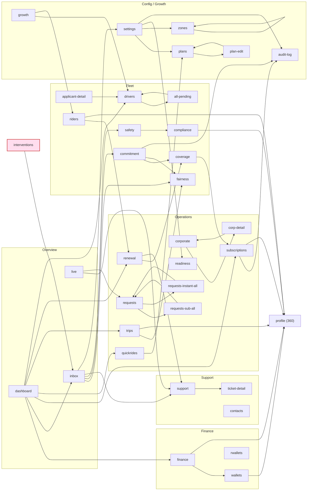

# Module Dependency Map — who reads what, who writes what, and where they collide

> **Source:** `eyvar_ops_panel_v40_fixed.html` (21,857 lines). `L####` = line in that file.
> **Machine inputs:** `docs/04-relations/data/db-usage-matrix.tsv` (1,183 read/write edges),
> `nav-edges-html.tsv`, `nav-edges-js.tsv`, `docs/00-index/GROUND-TRUTH-INVENTORY.md` §D (router map).
> **Module names** follow `docs/01-modules/` filenames.

---

## 1. How modules were identified

The file has no module boundaries — it is one 19,690-line `<script>` with section banners applied
retroactively (`grep '═══'` finds 41 banner blocks, none of which correspond to a page). The only
*mechanical* module boundary in the codebase is the router: `window.go(id, el, isBack)` at
`L8774`–`L8826` maps each of 41 page ids to the render functions that populate it.

Two derived mappings are used below:

1. **Entry-render read matrix** (§2) — mechanical. For each page, take the render functions the router
   invokes for it (99 `function → page` pairs extracted from `L8786`–`L8826`), then join against
   `db-usage-matrix.tsv`. This shows which collections a page touches *the moment you navigate to it*.
   It is a lower bound: helper functions called by those renderers are not attributed.
2. **Write attribution** (§3) — a two-pass extractor over `L2166`–`L21855`. Pass 1: direct
   `DB.x….=` / `.push` / `.unshift` / `.splice` / `delete`. Pass 2: function-scoped alias tracking
   (`var a = DB.x[…]` then `a.field =`). Result: **239 distinct (collection, function) write pairs
   across 87 collections**. Function attribution was hand-corrected for every collection cited in §3
   by resolving the enclosing function of each write line.

> The pre-extracted `db-usage-matrix.tsv` marks only 93 rows as `W` because its write detector
> matched only top-level `DB.x =` reassignment; it records **zero** writers for `riders`, `drivers`
> and `trips`, which is why §3 rebuilds the write side from scratch.

---

## 2. Module × collection matrix (entry-render reads)

Collections read by the render functions the router fires for each page. `●` = read on page entry.

| Collection | dash | live | subs | trips | quick | renew | ready | reqs | drivers | riders | fin | wallets | rwall | support | contacts | compl | safety | cover | commit | fair | zones | growth | pred | fraud | exec | plans | settings |
|---|---|---|---|---|---|---|---|---|---|---|---|---|---|---|---|---|---|---|---|---|---|---|---|---|---|---|---|
| `drivers` (112 fns) | ● | ● | ● | | ● | | ● | | ● | | | ● | | | | | | | ● | ● | | | ● | ● | ● | | ● |
| `riders` (112 fns) | | ● | ● | | ● | ● | ● | ● | | ● | | | ● | | | | | | | | | | | ● | ● | | ● |
| `subscriptions` (86) | ● | | ● | | | ● | | | | ● | | | | ● | | | | | | | | | ● | | ● | | ● |
| `trips` (61) | ● | | | ● | ● | | | | | | | | | | | | | | | ● | | | | ● | ● | | |
| `teamUsers` (56) | | | | | | | | | | | | | | ● | | | | | | | | | | | | | ● |
| `commitPolicy` (36) | | | | | | | | | | | | | | | | | | | ● | | | | | | | | ● |
| `upcomingSubTrips` (27) | | | ● | | | | ● | | | | | | | | | | | | | | | | | | | | |
| `tickets` (25) | | | | | | | | | | | | | | ● | ● | | | | | | | | | | | | |
| `opsConfig` (24) | | | | | | | | | ● | | | | | | | | | | | | | | | | | | ● |
| `rideRequests` (20) | | | | | | | | ● | | | | | | | | | | | | | | | | | | | |
| `liveTrips` (19) | | ● | | | | | | | | | | | | | | | | | | | | | | | | | |
| `plans` (18) | ● | | | | | | | | | | | | | | | | | | | | | | | | | ● | |
| `payments` (18) | | | ● | | ● | | | | | | | | | | | | | | | | | | | | ● | | ● |
| `subscriptionRequests` (16) | | | | | | | | ● | | | | | | | | | | | | | | | | | | | |
| `escrowHolds` | | | | | | | | | | | | ● | | | | | | | | | | | | | ● | | |
| `deductions` | ● | | | | | | | | | | | | | | | | | | | | | | | | | | |
| `refunds` | ● | | | | | | | | | | ● | | | | | | | | | | | | | | | | |
| `pendingDrivers` | ● | | | | | | | | ● | | | | | | | | | | | | | | | | | | |
| `disputes` | | | | | | | | | | | | | | ● | | | | | | | | ● | ● | | | | |
| `incidents` | | | | | | | | | | | | | | | | | ● | | | | | | ● | | | | |
| `complianceSuspensions` | | | | | | | | | | | | | | | | ● | ● | | | | | | | | | | |
| `subBackups` | | | | | | | | | | | | | | | | | | ● | | | | | | | | | |
| `slaPolicy` | | | | | | | | | | | | | | ● | ● | | | | | | | | | | | | ● |
| `zones` | | | | | | | | | | | | | | | | | | | | | ● | | | | ● | | |
| `newRiders` | | | | | | | | | | ● | | | | | | | | | | | | | | | ● | | |
| `onCall` | | | | | | | | | | | ● | | | | | | | | | | | | | | | | ● |
| `cities` | | | | | | | | | | | | | | | | | | | | | | | | | ● | | ● |
| `referralLog` | | | | | | | | | | | | | | | | | | | | | | ● | | ● | | | |
| `quickRideTypes` / `surgeConfig` / `surgeSchedule` | | | | | | | | | | | | | | | | | | | | | | | | | | ● | |
| `rateCard` / `rateCardHistory` / `surgeSuspensions` / `vatConfig` | | | | | | | | | | | | | | | | | | | | | | | | | | | ● |

**What the matrix shows.** `DB.drivers` is read on entry by 13 of the 27 sidebar pages and
`DB.riders` by 12. Nine collections are read by exactly one page (`liveTrips`→live,
`rideRequests`→requests, `subBackups`→coverage, `commitPolicy`→commitment+settings, …) — those are the
only genuinely module-local stores in the system.

---

## 3. Shared-write hazards — collections written by more than one module

This is the coupling map that matters. **49 of 87 written collections have more than one writing
function; 23 have three or more.** Ranked by number of distinct *modules* (not functions) that write:

| Rank | Collection | Distinct writer fns | Distinct modules | Writing modules | What can disagree |
|---|---|---|---|---|---|
| 1 | **`subscriptions`** | 18 | **9** | 05a Subscriptions · 05b Corporate · 06b Quick-ride engine · 07a Renewal · 07b Readiness · 07c Requests · 10b Plan commitment · 10c Coverage · 12a Finance | Nine modules mutate the same contract record. `completeTrip` (`L12458`, engine) increments the `'5/5'` trip counter; `renderSuccess` (`L11436`, renewal) resets it to `'0/N'`; `promoteBackup` (Coverage) rewrites `sub.driver`; `recordAbsence` (10b) writes `driverChanges`; `approveCorpSubscription` (05b) flips `status`. No module knows what the others changed |
| 2 | **`drivers`** | 13 | **9** | 05a · 06b · 08a Drivers · 08b Onboarding · 10a Fairness · 10b Commitment · 11a Growth · 12b Driver wallets · 16b History backfill | `recalcDriverTiers` (Growth, `L13610`) rewrites `d.lvl`; `decideFairness` (`L15625`) deletes `d.suspended`; `applyRatingUpdate` (engine) rewrites `d.rating`; `executePayout` (`L8731`) pushes into `d.notifLog`. The Drivers page owns none of it |
| 3 | **`riders`** | 11 | **8** | 05a · 05b · 06b · 07a · 07c · 09a Riders · 11a Growth · 16b PDPL/erasure | `finalizeNewSub` and `materializeSubscription` both unshift/push into `rider.subs[]`; `executeErasure` sets `r.erased`; `recalcRiderTiers` rewrites `r.lvl`; `openNewRiderProfile` **creates** rider rows |
| 4 | **`trips`** | 7 | **4** | 06b Quick-ride engine · 09b 360 Profile · 10a Fairness · 16b History backfill | **No function owned by the All Trips page writes `DB.trips`.** The page that displays trips cannot change them; four other modules can |
| 5 | **`rideRequests`** | 8 | **3** | 03a Dashboard (`assignManually`) · 06b engine (`commitNewRideRequest`, `driverAcceptOffer`, `pushRide`, `tickEngine`) · 07c Requests (`cancelRequest`, `commitRequestAssign`, `reqClearLocks`) | The dashboard can assign a request out from under the Requests page's lock (`reqClearLocks`) |
| 6 | **`liveTrips`** | 8 | **3** | 04 Live map (`commitAddStop`, `commitLiveReassign`, `confirmCancelLiveTrip`, `openTripChatView`) · 06b engine (`completeTrip`, `driverAcceptOffer`, `tickEngine`) · 07c Requests (`commitRequestAssign`) | See §4.1 — the divergence case |
| 7 | **`tickets`** | 12 | **4** | 13a Support (9 fns) · 07b Readiness (`createReadinessTicket`) · 09b 360 Profile (`createTicketFor`) · 15k Reason codes (`backfillReasonCodes`) | Three modules create tickets with three different shapes; `slaSweep` (`L14944`) then stamps all of them |
| 8 | **`upcomingSubTrips`** | 5 | **3** | 05a (`pushLeg` via `generateUpcomingTripsForSubscription`) · 06b (`tickEngine`) · 07b Readiness (`confirmPostponeTrip`, `logCallOutcome`) | Readiness mutates legs the Subscriptions module created and the engine ages |
| 9 | **`teamUsers`** | 9 | **3** | 15b Team & Roles · 15c Permissions · 00c My Account | `currentUserPagePerms` (`L10671`) and `renderPagePermMatrix` (`L10733`) both lazily *write* `u.pagePerms` during a **render** — a read path with a side effect |
| 10 | **`opsConfig`** | 8 | **2** | Settings (6 save fns) · 08a Drivers (`commitMultiSubChange`) | The Drivers page writes a settings blob |
| 11 | **`complianceSuspensions`** | 2 | **2** | 10d Compliance (`complianceScan` `L13307`) · 10e Safety (`precautionSuspend` `L13468`) | Two modules write free-text reason strings into the same map; five other modules read it (`10d-compliance.md` §13) |
| 12 | **`driverDocs`** | 2 | **2** | 08b Onboarding (`approveDriver` `L11113`) · 10d Compliance (`saveDriverDocDates`) | Onboarding seeds five expiry dates, defaulting blanks to *today + 1 year*; Compliance is the only page that ever sees them again |
| 13 | **`subBackups`** / `backupRegistry` | 2 (+2 boot) | **2** | 10c Coverage (`commitBackup`, `promoteBackup`) · 10b Commitment (`commitBoot`, `dispatchBoot`) | One object under two names (`L17198`) |
| 14 | **`refunds`** | 3 | **2** | 12a Finance (`recordRefund`, `backfillCreditNotes`) · 15k Reason codes (`backfillReasonCodes`) | |
| 15 | **`planConfirmations`** | 4 | **2** | 10b Commitment (`confirmPlanLeg`, `autoHandoff`, `respondBackupOffer`) · boot | |
| 16 | **`notifications`** | 3 | **2** | 03c Notifications (`handleNotifClick`, `markAllRead`) · global `pushOpsNotification` (`L9661`, called from ~36 producers) | |
| 17 | **`corpApprovalLog`** | 4 | **2** | 05b Corporate · 07c Requests (`approveSubReqCorp`, `rejectSubReqCorp`) | |
| 18 | **`complaints`** | 2 | **2** | 09b 360 Profile (`resolveComplaint`) · 15k (`backfillReasonCodes`) | Nothing creates complaints |
| 19 | **`payments`** | 2 | **2** | 07c Requests (`capturePaymentHold` `L9611`) · 16b History backfill (`buildRiderHistory` `L18766`) | **Neither is the Finance module.** Finance only reads |
| 20 | **`cashLedger`** / `driverCashDebt` | 2 / 2 | **2** | 06b engine (`maybeGenerateCashEvent` `L12101`) · 12b Driver wallets (`commitCashResolve`, `commitCashRepayment`) | |

**Single-module writers (healthy encapsulation).** `payouts` (12b only — `ensurePayoutEntry`,
`payDriver`, `confirmProcessAll`, `releaseEscrow`, `confirmApplyDeduction`), `corporateAccounts` (05b
only, 6 fns), `plans` (14a/14b only, 6 fns), `promos` and `incentives` (11a only), `cities`,
`paymentGateways`, `searchPhases`, `opsLimits`, `surgeSchedule`, `quickRideTypes`, `branding`,
`onCallSchedule` (Settings only). These are the modules whose boundary the code actually respects.

---

## 4. Four verified divergence cases

### 4.1 Live board vs Trips page — `DB.liveTrips` written, `DB.trips` not

**Confirmed.** `commitLiveReassign` (`L11794`–`L11802`) and `confirmCancelLiveTrip`
(`L11824`–`L11847`) were read in full: **neither contains the token `DB.trips`**.

- `commitLiveReassign` does `var t = DB.liveTrips.find(…); t.driver = drvId;` (`L11796`, `L11799`),
  then `logAction('reassign_driver','trip',id,…)` — the audit log records a **trip** mutation that
  never happened to a trip.
- `confirmCancelLiveTrip` does `DB.liveTrips.splice(idx,1)` (`L11834`) and logs
  `cancel_live_trip` with `after:{status:'cancelled'}` — `DB.trips[id].status` stays `'In trip'`.
- The three seeded live trips carry the **same ids** as three `DB.trips` records
  (`TRP-7741`, `TRP-9012`, `TRP-7742`, `L2782`–`L2782` vs `L2671`–`L2679`), so the divergence is
  immediately visible: reassign `TRP-7741` on the Live board and All Trips still shows Ahmed Salem,
  status "In trip".
- **The asymmetry is the tell:** `completeTrip` (`L12406`) *does* sync — it splices the live row
  (`L12409`), looks up or creates `DB.trips[t.id]` (`L12410`, `L12421`) and sets `base.status='Done'`
  (`L12424`). Completion was wired; reassign and cancel were not.

### 4.2 `d.docStatus` — read by Drivers, written by nobody

**Confirmed.** The token `docStatus` occurs exactly four times in 21,857 lines:

| Line | Context | Read/write |
|---|---|---|
| `L6380` | `renderDriversTable` filter: `if(_driverFilter==='docs') return d.docStatus==='expiring' \|\| d.docStatus==='expired';` | read |
| `L20925` | `renderFleetCounts`: `d.filter(function(x){return x.docStatus==='expiring'\|\|x.docStatus==='expired';})` | read |
| `L7093`, `L10847` | `docStatusMeta(statusText)` — a **different** identifier, an applicant-document badge helper | n/a |

No seeded driver has a `docStatus` field (`L2632`–`L2632`) and no code assigns one. The Drivers
page's "Documents expiring" filter and the fleet-count tile are therefore permanently zero.

The real data is `DB.driverDocs` (`L13278`) — 5 ISO expiry dates per driver. Its readers:
`complianceScan` (`L13300`), `renderCompliancePage` (`L13343`), `driverRiskScore` (`L14286`, using a
**14-day** threshold that exists nowhere in Compliance — `10d-compliance.md` §13), the applicant
approval warning (`L7180`) and the expiry card (`L10999`). **The Drivers page never reads
`DB.driverDocs`.** Two modules, two datasets, one question.

### 4.3 Four disjoint pricing models

Independently re-verified against `16g-settings-pricing-windows.md` §10.1 and the source:

| # | Model | Data | Entry point | Actually prices |
|---|---|---|---|---|
| 1 | Rate card | `DB.rateCard` `L21431` | `fareFor` / `planQuote` `L21467`/`L21484` | **Nothing** — display only. Confirmed: no consumer outside `L21413`–`L21775` |
| 2 | Quick-ride types × schedule surge | `DB.quickRideTypes` `L13908` × `DB.surgeConfig` `L13861` + `DB.surgeSchedule` `L13883` | `quickRideFare()` `L12401` via `currentSurgeMultiplier()` `L12389` | Live fare preview `L2477`, new-request commit, `completeTrip`'s auto-materialised fare `L12421` |
| 3 | Plan template rates | `DB.plans[*].ecoMin/ecoKm/comfortMin/comfortKm` `L2889` | `perTripBaseRate` fallback `L4551` | Subscription quote **only when no route is picked** |
| 4 | Hardcoded reconstructor | literals `base=4.00, perKm=1.35, perMin=0.42` `L18657` | `buildFareBreakdown` `L18656` | Every reconstructed historical trip/payment |

Plus a **fifth** frozen price table that outranks all four for the flow that matters:
`var PLANS = {weekly:{exec:5, eco:86.50, comfort:122.50}, …}` at **`L4389`**. `finalizeNewSub`
(`L5085`), `materializeSubscription` (`L9623`) and `renderSuccess` (`L11425`) all price from `PLANS`,
**not** from `DB.plans`. Editing a plan's price in the Plan Editor changes nothing a rider pays; the
only field of `DB.plans` that reaches a live calculation is `eyvarPct`, via `commissionRateForPlan`.

Four different Economy per-km rates coexist — **1.20** (rate card), **1.10** (quick-ride type),
**1.10** (`plans.weekly.ecoKm`), **1.35** (reconstructor).

### 4.4 Driver payouts bypass the double-entry ledger

`DB.ledger` (`L19879`) with `postLedger` (`L19917`), idempotency (`L19880`) and a trial balance is the
system's declared money-safety layer. Its 7 call sites are `L19969` (refund), `L19985` (wallet
credit), `L19997` (wallet debit), `L20014`/`L20018` (emergency cover/recovery), `L20040`/`L20045`
(fare capture / driver accrual). **None of the four functions that actually move payout money posts
to it**: `payDriver` (`L7023`), `confirmProcessAll` (`L7049`), `releaseEscrow` (`L7058`),
`confirmApplyDeduction` (`L7072`). Settings ▸ Ledger's trial balance can never reconcile against
Driver Wallets.

---

## 5. Navigation graph

Built from `nav-edges-html.tsv` (26 page→page edges) and `nav-edges-js.tsv` (56 function→page edges),
with the source functions resolved to their owning pages.

> **Correction to the extracted data.** A direct scan finds **135 `go(…)` call sites across 37
> distinct target pages**, not the 82 the two files contain. The 53 missing sites use escaped quotes
> inside generated HTML strings — `onclick="…go(\'live\',null)"` (e.g. `L8251`, `L8452`) — which the
> extractor's `go\('…'` pattern skips. The counts in §6 use the corrected scan.

*Global producers not drawn as page nodes:* the notification panel (`handleNotifClick` `L2272`–`L2276`
→ `support`, `drivers`, `renewal`, `wallets`), toasts (any module → any page), and
`impersonate`/`stopImpersonating` (`L21076`, `L21087` → `dashboard`).

---

## 6. Orphan analysis

**41 pages · 135 `go()` call sites · 37 distinct targets.**

### 6.1 Pages that are never a `go()` target (in-degree 0 through the router)

| Page | Div | Why | Verdict |
|---|---|---|---|
| `interventions` | `p-interventions` `L2068` | Has a router branch (`L8788`) and a renderer (`renderInterventionsPage` `L10338`). **No `go('interventions')` exists anywhere.** No sidebar item | **True orphan — unreachable.** It also *emits* an edge (`go('inbox')` `L2073`), so it is exactly the "links out, receives nothing" case. Worse, `refreshOwnershipSurfaces` (`L19054`) tries to refresh it by calling `renderInterventions()` — a function that does not exist |
| `profile` | `p-profile` `L1384` | Shown by `document.getElementById('p-profile').classList.add('on')` inside `openProfile` (`L8834`) | Reachable, but **bypasses the router** — `titles`/`subs`, sidebar highlight and `pushHistory` are all handled manually |
| `applicant-detail` | `L1342` | Same pattern (`L8873`) | Router-bypassing |
| `ticket-detail` | `L1380` | Same pattern (`L8885`) | Router-bypassing |

The three router-bypassing pages are why `goBack()` is unreliable: `navCurrent` (`L2914`) is set by
`go()` only, so returning from a profile restores the page you were on *before* the profile only when
the opener remembered to push history itself.

### 6.2 Pages reachable **only** from the sidebar

Exactly one `go()` call site exists for each, and it is the sidebar item. Nothing anywhere in the
product links to them:

| Page | Sidebar line | In-app inbound links |
|---|---|---|
| `exec-overview` | `L487` | 0 |
| `predictive` | `L491` | 0 |
| `fraud` | `L492` | 0 — and `02b-fraud-and-risk.md` §12 notes **no `go(…)` originates from the Fraud page body either**: it is a leaf in both directions |
| `growth` | `L522` | 0 |
| `rwallets` | `L529` | 0 — even though `creditRiderWallet` is called from six other modules |
| `contacts` | `L533` | 0 |

Six of the 27 sidebar destinations are dead ends in the workflow graph. Three of them
(`predictive`, `fraud`, `exec-overview`) are the analytical layer — the system computes risk scores
and never routes anyone to them.

### 6.3 In-degree ranking (corrected scan, sidebar entry excluded)

| In-degree | Pages |
|---|---|
| 12 | `commitment` |
| 11 | `wallets` |
| 9 | `drivers` |
| 6 | `fairness` |
| 5 | `zones`, `requests-sub-all`, `plans`, `compliance` |
| 4 | `support`, `settings`, `requests`, `live`, `dashboard`, `audit-log` |
| 2–3 | `subscriptions`, `safety`, `renewal`, `quickrides`, `inbox`, `finance`, `coverage`, `corporate` |
| 1 | `trips`, `riders`, `readiness`, `requests-instant-all`, `my-account`, `plan-edit`, `notifications-all`, `corp-detail`, `all-pending` |
| 0 | `exec-overview`, `predictive`, `fraud`, `growth`, `rwallets`, `contacts`, `profile`, `applicant-detail`, `ticket-detail`, `interventions` |

`commitment` and `wallets` are the system's true hubs — every module that discovers a problem routes
the operator to one of them. Neither is where the operator starts.

### 6.4 The router as a coupling point

`go()` hard-references **77 distinct render functions** (`00a-global-navigation-and-routing.md` §13)
across every business module, in one 53-line `if` chain (`L8786`–`L8826`). Adding a page means editing
five separate places: `titles` (`L2168`), `subs` (`L2169`), the page `
`, the sidebar item, and the
`go()` chain. The `settings` branch alone calls **34 render functions** in one statement (`L8819`), so
opening Settings re-renders every one of the 21 settings panes whether or not you look at them.

There is also a **duplicate branch**: `support` is handled twice, at `L8789` (`renderSupportTeam()`)
and `L8806` (`renderTkFilterSelect(); renderTickets(); renderDisputes(); renderLostFound()`). Both
run on every navigation to Support.
