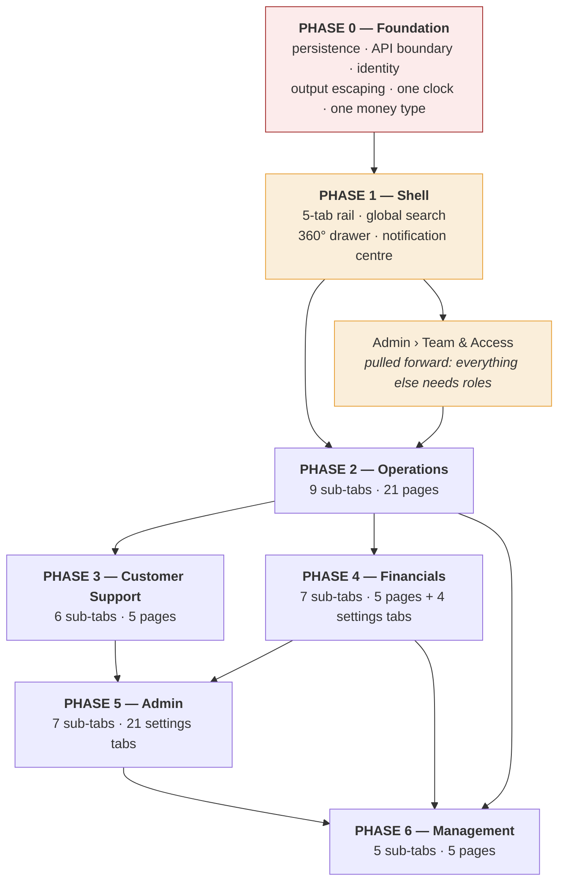

# Migration Notes

> **Companion to** [`PROPOSED-STRUCTURE.md`](PROPOSED-STRUCTURE.md) and [`PAGE-TRACEABILITY-MATRIX.md`](PAGE-TRACEABILITY-MATRIX.md).
> **Written for:** the engineering lead and whoever is accountable for the delivery date.
> **Position:** this is a rebuild sequenced behind a foundation, not a re-organisation of an existing working system. Section 1 explains why that is not negotiable.

---

## 1. The blocker: nothing is saved

Before any of this is worth building, one fact has to be dealt with.

```
grep -n "localStorage\|sessionStorage"  eyvar_ops_panel_v40_fixed.html  →  0 matches
grep -n "indexedDB\|document.cookie"                                    →  0 matches
grep -n "fetch(\|XMLHttpRequest"                                        →  0 matches
```

Verified independently in three module documents (`00b` §9.1, `00d` §4, `03c` §13). **All 101 `DB` collections live in one in-memory JavaScript object literal.** Every driver approval, every payout, every refund, every suspension, every settings change, every audit entry and every read-notification flag is destroyed by F5.

This is not a missing feature. It changes what the other findings mean:

- **The audit log is not an audit log.** 220 `logAction()` call sites write to an array that does not outlive the tab. The confirmation gates promise *"Recorded in the activity log under your name"* on 88 actions (`00b` §12 item 15). That promise cannot currently be kept.
- **The permission model is decoration.** `CURRENT_USER_ID = 'USR-1'` is a module-scope `var` (L2862). There is no login, no token, no session. Every reload resets the acting user to the Owner. Any operator can also switch identity from the topbar avatar — which is how the rate card's four-eyes approval is defeated: `approveRateCard` compares `draft.proposedBy` to `CURRENT_USER_ID` (`16g` §12 item 7).
- **The ledger is a model, and says so.** `16h` states it outright: *"This is a model, not an accounting system. Its purpose is to be an unambiguous specification for the backend."* That is the right framing for the whole file.

**Therefore: Phase 0 is not optional and nothing ships in front of it.** If the business needs something visible sooner, take the quick wins in §6 — they are real and they do not depend on the backend.

---

## 2. Sequencing at a glance



**Why Management is last, even though it is Tab 1.** Every Management widget is an aggregate of numbers computed inside the other four workspaces. Building it first means building it on the current fabricated figures, which is exactly the failure mode we are trying to remove. Executives get an accurate dashboard once the operational surfaces feeding it are accurate — not before.

**Why Admin › Team & Access is pulled forward.** Roles gate everything. Without it, every workspace ships with the current model, which enforces `view_profiles` at zero call sites and covers 22 of 41 pages.

---

## 3. Phase 0 — Foundation (blocks everything)

| # | Deliverable | Why it must come first | Evidence |
|---|---|---|---|
| 0.1 | **Persistence + a real API boundary.** Every `DB.<collection>` becomes a resource. Reads and writes go over the wire. | Nothing else means anything without it. | `00b` §9.1 |
| 0.2 | **Identity and sessions.** Real login, real token, real acting user. Impersonation becomes a server-side, audited capability rather than a `var` reassignment. | Two identity mechanisms exist today and **do not cooperate** — `commitUserSwitch` never sets `window.__realUserId` and never calls `renderImpersonationBar` (`00c` F4). | `00c` §2.2 |
| 0.3 | **Server-side authorisation.** Permission checks move to the API. The client gate becomes a UI affordance, not a control. | `window.__skipGuards` is a public global that disables all 88 confirmation gates. `guardAction` monkey-patches `window[name]` at load, so any reference captured earlier bypasses the gate. A `builder` exception is swallowed and `spec=null` **means the action runs unguarded**. | `00b` §12 items 8–11 |
| 0.4 | **Output escaping, everywhere.** No `innerHTML` string concatenation of `DB` values. | 99 modals, 349 toasts and every table interpolate unescaped values. `toast()` strips tags only for the `title=` attribute, not the visible message. The moment real rider-entered names or ticket subjects arrive, this is an injection vector. It is also the reason the panel cannot run under any reasonable CSP (`unsafe-inline` for hundreds of `onclick=`, `unsafe-eval` for `new Function(onChangeExpr)` at L5411). | `00b` §12 items 5, 24 |
| 0.5 | **One money type.** Integer minor units. No `'86.50 SAR'` strings. | `DB.payments[*].amount` is a display string; every consumer does `parseFloat`. `riderLTV`'s parse does not strip thousands separators, so `'1,040.00 SAR'` contributes **1** (`09a` §17 item 10). `renewalRate` is stored as `'100%'` / `'—'`, and `parseInt('—')` produces the `NaN%` on the executive dashboard. | `12a` R13, `01` §17.1 |
| 0.6 | **One clock, server-side.** Kill `EYVAR_TODAY` = 25 Jun 2026 and every hardcoded date. | The demo date is baked into export filenames (`doExport` writes `_25Jun` into every file, L9143), into map date labels, and into the readiness window. Meanwhile `currentBlock()` / `currentDayKey()` in the on-call rota use the **real** wall clock while everything else is pinned — two clocks in one app (`16i` §12 item 4). | `16f` §12.7, `16i` §12.4 |
| 0.7 | **Id generation server-side, gapless where required.** | `approveDriver` generates `'DRV-0'+(106+random()*90)` with **no uniqueness check, and `DRV-0106` already exists**. `materializeSubscription` generates `'SUB-'+(1200+rand(800))` with no collision check. `'MAIL-'+(length+1)`, `'PUSH-'+(length+1)`, `'REF-'+(length+1)` and `'CORP-'+(length+1)` are all non-monotonic and collide the moment anything is deleted. | `08b` §17.6, `07c` §19.4, `16d` §11.5 |
| 0.8 | **Idempotency on every money path, keyed properly.** | Today wallet credit/debit idempotency is **one second wide** — a double-click slower than 1s pays out twice. The refund key has no time component, so two legitimately distinct refunds of the same amount to the same rider collide. A rejected posting is not retryable because the key is recorded regardless of outcome. | `16h` §12 items 5, 8; `12a` R9 |
| 0.9 | **Retire the 1 Hz tick engine.** Real events come from the server. | It is never cleared, has no visibility or idle pause, runs `Math.random()` simulations, and mutates `DB` forever including in a backgrounded tab. | `00b` §12 item 26 |

**Phase 0 acceptance test:** approve a driver, refund a subscription, change a dispatch radius, log out, log in as a different user, and see all three changes with the correct actor attribution in the audit log. Today, all three vanish.

---

## 4. Phase 1 — The shell

Everything in this phase is used by all five workspaces, so it is built once and built properly.

| # | Deliverable | Notes |
|---|---|---|
| 1.1 | **The 5-tab rail** with per-role default landing and per-role visibility (`PROPOSED-STRUCTURE` §10). | Replaces the 9-section sidebar. Keep the hover-expand icon rail — it is a sanctioned deviation (`06-eyvar-mapping` §6.2 item 4) and screen width matters for the map and wide tables. |
| 1.2 | **URL routing.** Every tab, sub-tab, view and detail gets an address. | There is currently **no URL routing, no hash, no History API** — navigation state lives in two JS globals (`navStack`, `navCurrent`). You cannot bookmark, share, or deep-link anything. This is why `interventions` became unreachable. |
| 1.3 | **The 360° profile drawer.** One shell, 11 entity types, opens over the current workspace, scoped back-stack. | `openProfile` already has **100 call sites** — the highest-value single component in the rebuild. Extend `resolveId` from 6 buckets to 11 (add `tickets`, `pendingDrivers`, `corporateAccounts`, `newRiders`, `plans`) so global search stops returning "No record found" for ids that have working detail screens. Fix first-match-wins name search — today searching a shared surname silently picks one of two people. |
| 1.4 | **Global search.** Entities + sub-tabs + actions. | The escape hatch that makes a 5-tab structure survivable during the transition: someone who cannot find Cancellation Policy searches for it and lands in Financials › Pricing & Plans. |
| 1.5 | **Notification centre** as the bell's expanded state. | Fix the three defects on the way: `alert` (16 producers, the most common type) has **no click destination**; `renewal`/`approval`/`complaint` have full routing and no producer; read flags must persist. |
| 1.6 | **Index-table component** — sortable columns, view tabs, filters, bulk action bar, empty states, pagination. | Reused by ~14 sub-tabs. The design reference already specifies it (`06-eyvar-mapping` §6.4). Fix D8 while building it: row actions are `opacity:0` until hover, invisible to keyboard and touch users. |
| 1.7 | **Design-token cleanup** — D1, D5, D6, D11 from `06-eyvar-mapping` §6.3. | Canvas/surface collapse (pages and cards are both white), 11 undocumented badge tones, two parallel status systems (`.b-*` vs `.health`/`.days-*`), and no visible focus ring. These four compound with every screen built on top of them. |
| 1.8 | **One modal system** with ESC handling, focus trap and focus restore. | Zero `Escape` handlers exist today; there is no `role="dialog"`, no `aria-modal`, and tab order leaks behind the scrim. Also fix: `closeModal()` calls `reqClearLocks()`, which wipes `claimedBy` on **every** ride and subscription request whenever **any** modal closes — including modals with nothing to do with requests. |

**Phase 1 acceptance test:** paste a URL for *Financials › Pricing & Plans › Plan editor · weekly* into a fresh browser and land exactly there, with the correct tab highlighted and a working back path.

---

## 5. Phases 2–6 — Workspaces

### Phase 2 — Operations (largest, highest daily value)

Build order within the phase, by dependency:

1. **People** — the captain and rider rosters, applications and compliance. Everything downstream references these records. Fixes on the way: assign `d.docStatus` (read in two places, written nowhere); give every driver a `driverDocs` entry (`DRV-0106` has none and can never be auto-suspended); block approval on unverified documents (`approveDriver` reads none of the KYC fields); stop hardcoding `decidedBy: 'Sarah Al-Rashid'`.
2. **Requests** — one index, three pages collapsed, SLA clock, claim/assign. Fixes: the engine must actually set `status='assigned'` rather than splicing; `reopenSubReq` must stop rewriting `requestedAt` to now and destroying the original ask; render `r.notes` (the rider's stated preference is currently invisible).
3. **Subscriptions + Corporate** — the money/relationship levers. Fixes: **settlement must move money** (`commitSettlement` currently flips a status and nothing else); add an unfreeze path (`Frozen` has no exit); read the freeze reason; delete the dead search box; stop hardcoding the settlement audit `before` state.
4. **Trip Assurance** — readiness + coverage + commitment. Fixes: apply a real 24-hour window; remove trips from the board on departure; enforce or delete the 21:00 confirmation deadline; **post forfeitures** (currently logged, never debited); retire the capacity grid until `slotOf()` handles AM/PM.
5. **Trips** — the ledger, quick rides and route history. Fixes: one type-badge mapping and one status-badge mapping (there are currently two of each for the same field); one Eyvar-cut formula (table and receipt disagree); delete the dead no-show KPI and filter.
6. **Live Dispatch** — map, dispatch board, live interventions. Fixes: delete the ~120 lines of dead Leaflet code and both unpkg `<script>`/`<link>` tags; make `commitLiveReassign` and `confirmCancelLiveTrip` update `DB.trips`, not only `DB.liveTrips`; stop toasting "rider notified" when nothing is sent.
7. **My Work** — the deadline-ordered router. Fixes: align `WORK_ROUTING` to real role names (11 of 12 queues route to `'Operations'`, which is not a role); stop mutating state during render (`whoHolds()` expires stale claims and writes audit rows as a *read* side effect); make the sidebar badge add rather than `||`; point `#my-work-chip` at the inbox instead of Support Center; replace `new Function(item.action)` string-eval.
8. **Overview** — last, once its inputs are real.

### Phase 3 — Customer Support

Build order: **Tickets** → **Contact Centre** → **Disputes & Claims** → **Safety & Incidents** → **Captain Fairness** → **Overview**.

Prerequisite: the reason-code taxonomy and SLA policy (currently Settings › `reasons`, moving to Admin › Operational Policy) must land first — every ticket, dispute, complaint, fairness case and call is coded against it. Build that pane in Phase 3, not Phase 5.

Fixes on the way: give `Waiting on customer` a setter (it is the sole trigger for the SLA pause branch and no button sets it); make T1 first-response SLAs breachable (all five T1 codes set `fr:0`, so a Critical ticket left unanswered forever never breaches); render `Critical` priority in a colour; **allow disputes and lost-item cases to be created**; **allow incidents to be created, reopened, and precautionary suspensions to be lifted**; make `resolveDispute` actually post the credit it promises; give an upheld fairness case a downstream effect.

### Phase 4 — Financials

Build order: **Pricing & Plans first.** Everything else prices off it, and the four-model contradiction has to be resolved before Payouts can be trusted.

Then **Ledger & Payment Controls** → **Payouts & Escrow** → **Cash & Captain Debt** → **Revenue & Refunds** → **Rider Wallets** → **Overview**.

**Hard prerequisite:** the business must name the single source of truth for commission. Today captain earnings are computed four ways — escrow embeds a flat 20%, `reconstructHistory` hardcodes 20%, the rate card says 22% for on-demand, and each plan carries its own editable `commission`. That is not a rounding difference; it is four different answers to "what do we pay a captain."

Fixes on the way: implement the escrow lifecycle (nothing creates a hold, increments `tripsCompleted`, or transitions `held → ready`); implement cash-debt deduction from payouts (the UI says "auto-deducted from the next payout" and it is not); gate `waiveDeduction`; check hold status inside `releaseEscrow` rather than only in the renderer; stop double-booking refunds (`confirmCancelSub` calls both `recordRefund` **and** `creditRiderWallet` for the same money); mark refunded payments `Refunded`; put a ceiling and an authority check on `recordRefund`; make gateway `enabled`/`isDefault` actually gate a charge path, or delete the toggles.

### Phase 5 — Admin

**Team & Access is pulled forward to Phase 1.5** — see §2.

The rest builds in this order: **Operational Policy** (needed by Operations and Support) → **Communications** → **Data & Compliance** → **Workspace** → **Activity Log** → **Overview**.

Fixes on the way: split `manage_settings` into three keys (39 of 131 guards, one holder — see `PROPOSED-STRUCTURE` §10.5); add a `PAGE_PERMISSIONS` entry for all 34 sub-tabs (currently 22 of 41 pages); enforce `view_profiles` somewhere; gate every export; label the 135 unlabelled audit action keys; merge the two logo stores; delete `renderOnCall()` and the orphaned `#oncall-body`; make `switchSettingsTab` actually render its pane rather than firing all 21 renderers on page entry.

### Phase 6 — Management

Build last. **Performance** → **Risk & Signals** → **Market & Zones** → **Growth** → **Overview**.

Prerequisite: daily snapshots must be captured by a server job, not by an operator remembering to press a button. The current card admits it: *"This file has no server to auto-capture at midnight, so capture manually (or right before an export) until this is wired to a real backend job."* The trend chart on the executive dashboard reads those snapshots.

Growth is the one sub-tab I would consider deferring entirely. There is **no promo redemption engine anywhere in the file**; `spent`, `uses` and `newSubs` are never incremented; `perUserLimit`, `target` and `expires` are inert; `sendBulkMsg` sends nothing. This is a product to be built, not a screen to be migrated. Shipping the UI without the engine puts a "Create promo code" button in front of a marketing hire and gives them a code that does nothing at checkout.

---

## 6. Quick wins — do these now, they do not wait for Phase 0

These are cheap, visible, and reduce real risk in the current file while the rebuild runs.

| # | Fix | Effort | Why now |
|---|---|:--:|---|
| Q1 | **Delete `demoDoubleRefund()`** (L20104, L20131). | 5 min | It issues **two genuine 25.00 SAR refunds** against whichever rider happens to be first, with no confirmation and no permission gate. A demo button wired to a live money path. |
| Q2 | **Delete the dead Leaflet layer and both unpkg tags** (L469–470, L11526–L11635). | 30 min | Two render-blocking third-party requests with no SRI, no `crossorigin`, no defer and no fallback — for ~120 lines of code that nothing calls. Removes a supply-chain dependency and speeds up first paint. |
| Q3 | **Remove the 11 fabricated KPI tiles** (Finance ×7, Quick Rides ×4). | 1 h | They contradict live tables inches away. Deleting them is strictly better than leaving them; an empty space is honest. |
| Q4 | **Fix the `NaN%` on the executive dashboard.** | 15 min | It is the first screen the Owner sees and it renders `NaN%` on shipped data. |
| Q5 | **Guard the escrow progress bar** against `tripsRequired === 0`. | 10 min | Currently emits `style="width:NaN%"`. |
| Q6 | **Point `#my-work-chip` at the work inbox** instead of Support Center. | 5 min | The chip reads "✋ N mine" and navigates somewhere else entirely. |
| Q7 | **Give the `Open alerts` KPI a click target.** | 15 min | It is the one dashboard tile with no destination, and the one people most want to click. |
| Q8 | **Add confirmations to the 7 ungated destructive actions** — `removeCity`, `removeRideType`, `removeGateway`, `removeCustomLimit`, `removeEmployeeFromCorp`, `removeAvatar`, `commitUnflagAccount`. | 1 h | Their *less* destructive counterparts are already gated. The asymmetry is an accident. |
| Q9 | **Gate every export** behind a permission. | 2 h | A Support user with 3 permissions can currently export the full payments table and the entire audit log. |
| Q10 | **Add the 135 missing `ACTION_LABELS` keys**, starting with the security-relevant ones (`impersonation_started`, `account_suspended`, `erasure_executed`, `toggle_page_permission`, `change_password`). | 2 h | 84% of audit actions cannot be filtered. An auditor cannot search for an impersonation. |
| Q11 | **Delete `renderOnCall()` and the orphaned `#oncall-body` lookup.** | 10 min | It is called on every settings render and targets an element that does not exist. |
| Q12 | **Correct the census summary line** in `GROUND-TRUTH-INVENTORY.md` §B: 30 nav items, not 27. | 2 min | The table already says 30; only the summary is wrong. Keeps the audit baseline trustworthy. |

---

## 7. Defects that must NOT be carried forward

Grouped by class. Each line is a decision, not a bug report: *fix it, or delete the affordance.* Shipping the affordance without the behaviour is the worst of the three options, because it teaches people the panel lies.

### 7.1 Fabricated numbers presented as data

- All 7 Finance KPI tiles (`L930–L940`) — hardcoded, and contradicting the table 10 rows below (net `9,246`/`19.2%` vs `8,752`/`18.1%`).
- All 4 Quick Rides KPI tiles (`L1135–L1138`) — numbers, deltas **and bar widths** hardcoded above a live table.
- Revenue-by-plan table (`L949–L960`).
- Retention cohorts (`renderCohorts`, never reads `DB.subscriptions`).
- CSAT / NPS (`renderCsat`, a static HTML string; no survey trigger anywhere).
- Two decorative progress bars on Coverage with fixed 70% / 40% widths that never reflect data.
- `exec-overview` "New riders (48h)" — no time filter is applied.
- Zone `demand` / `supply` / `failures30d` — never computed from live data.

### 7.2 Buttons that lie

Every one of these renders as a working control, produces a success toast, and writes nothing meaningful:

`resolveAlert` · `reviewDriver` · `sendDriverIncentive` / `confirmDriverIncentive` · `sendBulkMsg` · `commitSettlement` (moves no money) · `resolveDispute` (posts no credit) · `finalizeReassign` (applies no compensation) · `sendRiderChangeNotif` (discards the operator's message) · `Save search phases` (writes nothing) · `logCallOutcome` for `cancelled` and `delay` · the Subscriptions search box (no `id`, no handler) · `renderSuccess` in the renewal wizard (no audit entry, no `DB.payments` record).

### 7.3 Settings that are stored, audited, and enforced nowhere

`currency` · `timezone` · `support email` / `phone` · `sessionTimeoutMin` · `require2FA` (and there is **no way to enrol a user in 2FA**) · gateway `enabled` / `isDefault` · 5 of 8 `opsLimits` · `graceMin` and 3 of 8 cancellation scenarios · `reasonCode.owner` (*"the field that turns a metric into somebody's backlog"*) · `reasonCode.target` · `breachEscalateTo` · the entire `DB.rateCard` (nothing outside the pricing module reads it — **no trip, quote or invoice is priced from it**) · `promo.perUserLimit` / `target` / `expires` · `DB.branding.accent` · plan `sortOrder` / `ecoActive` / `comfortActive` / `nameAr` · `DB.onCallSchedule.overrides` (read, never written) · `workHoursOnly` on corporate policy · `DB.arrivalConfig.riderGraceMin`.

**Rule for the rebuild:** a setting ships with its enforcement point, or it does not ship. The one tab that already does this honestly is Operational Limits, which labels each row `● Live` or `● Tracked` and is verifiably accurate — copy that pattern or delete the row.

### 7.4 Duplicated and contradictory models

| Duplication | Detail |
|---|---|
| **Four pricing models** | `DB.plans` · `PLANS`/`CADENCE_META`/`CADENCE_DAYS` · `DB.quickRideTypes`+`surgeSchedule` · `DB.rateCard`. The new-subscription modal iterates `PLANS`, never `DB.plans`, and never checks plan `status` — so a Draft or Archived plan is still purchasable. |
| **Four commission rates** | escrow 20% (flat) · `reconstructHistory` 20% (hardcoded) · rate card 22% (on-demand) · per-plan editable `commission`. |
| **Two logo stores** | `DB.branding.logoUrl` (sidebar) vs `DB.opsConfig.general.logoDataUrl` (favicon). Never synchronised. |
| **Two rating limits** | `driver_min_rating_for_dispatch` (3.5★, enforced) and `driver_min_rating` (3.5★, dead). Same value, same unit, one is a trap. |
| **Two type-badge mappings and two status-badge mappings** for the same trip field, so one record renders in two colours on two pages. |
| **Two Eyvar-cut formulas** — table: `fare − driverEarn − stopFee`; receipt: `fare − driverEarn`. |
| **Two intervention counts** — dashboard applies a 60-minute cut-off; the standalone page does not. |
| **Two health-score colour bands** — 70/40 vs 80/50 for the same score. |
| **Two "today" definitions** for email and push — a string match on a date label, not a time window. |
| **Two audience lists** — email offers 9 segments, push offers 11, with different keys for "all riders". |
| **Two clocks** — everything is pinned to 25 Jun 2026 except the on-call rota, which uses `new Date()`. |
| **Two CSV encoders** — `toCSV` quotes conditionally, `buildCSV` quotes everything; both are live. |
| **Two export paths** — a superior modal offering CSV *or* JSON with a save-location picker exists and is **unreachable** from the Data Export tab. |

### 7.5 Governance failures

- **`view_profiles` is enforced at zero call sites** while `openProfile` has 100 call sites and shows full PII, trip history, documents and payments.
- **19 of 41 pages have no `PAGE_PERMISSIONS` entry**, including Fraud, Rider Wallets, Corporate detail, the 360° profile, Applicant detail and Contact drivers. An administrator reading the permissions screen cannot see that they exist.
- **`manage_settings` is 30% of all permission guards and has one holder.** Bus factor 1 over cities, gateways, dispatch, security, legal, retention, reason codes, SLA, rota and PDPL erasure execution.
- **No export is permission-gated**, including `exportAuditLog` — which lets any operator take the tamper record off-platform, and which appends its own `export_data` row so the CSV never contains the export that produced it.
- **135 of 161 audit action keys (84%) are unlabelled** and therefore unfilterable.
- **`exportRequestsSnapshot` is the only bulk export that does not call `logAction`.**
- **`rebuildAllHistory()` writes hundreds of records with no permission gate** — the most destructive action in the Settings module.
- **The rate card's four-eyes approval is defeatable** by switching acting user from the topbar.
- **The "second approver" on compensation is a global boolean** (`window.__compApproved`) — pressing Confirm twice satisfies it.

### 7.6 Architectural patterns

`innerHTML` string concatenation with no escaping · `new Function(onChangeExpr)` and `new Function(item.action)` string-eval · `guardAction` monkey-patching `window[name]` · the public `window.__skipGuards` kill switch · a `MutationObserver` on the entire `document.body` subtree purely to auto-size `<select>` elements · an unguarded 100 ms init pass of 45 sequential calls where one throw kills everything after it (including `startTickEngine()` at position 42) · three uncoordinated document-level click listeners and two window resize listeners, none removable · a boot IIFE whose required last position is documented in capitals and enforced by nothing · `TOAST_MAX = 1`, which silently drops every alert but the last when several fire in one tick.

---

## 8. Data-model work that must happen alongside

| # | Item | Why |
|---|---|---|
| 8.1 | **Fold `newRiders` into `riders`** with an `onboardingState`. | A separate array means `RDR-3001` resolves to nothing in global search until someone clicks "View" to promote it. |
| 8.2 | **Fold `pendingDrivers` into `drivers`** with an `applicationState`. | Same reason, plus it closes the `DRV-0106`-has-no-docs gap structurally. |
| 8.3 | **Give every driver a `driverDocs` record on creation.** | Missing records are invisible to `complianceScan()` and can never be auto-suspended. |
| 8.4 | **`backupRegistry` is an alias of `subBackups`, not a copy.** Pick one name. | Two names for one object reference across two modules is a maintenance trap. |
| 8.5 | **Normalise the 40 reason codes** as a first-class table with an owning team, a target audience, and SLA clocks — all three of which are currently stored and unread. | This is the spine of support measurement and the thing that makes CPT-by-owner work. |
| 8.6 | **Decide what `dateMs` is.** Today it exists only on reconstructed trips, so `tripsTable()` sorts everything else at `0`. | Every trip needs a real timestamp. |
| 8.7 | **Resolve the ledger's incomplete coverage.** | Driver payouts, escrow release, deductions and tips do **not** post. `liability.driver` is a monotonically increasing accrual that never clears; `liability.escrow` and `ar.rider` are declared and permanently zero. |
| 8.8 | **Define the retention window as a legal answer.** | `DB.dataWindow.months = 13` with an in-source comment marking the payment-network dispute window as **unconfirmed**. Under PDPL this is not an engineering default. |

---

## 9. Rollout

**Do not big-bang.** Run the new shell alongside the current file behind a role flag:

1. **Phase 1 complete** → give the 5-tab shell to one Ops Manager with Operations only. Everything else routes back into the old sidebar. Two weeks of real shifts.
2. **Phase 2 complete** → all Ops users move. Old sidebar stays reachable for the other four sections.
3. **Phases 3 and 4 complete** → Support and Finance move. Old sidebar now serves Admin and Management only.
4. **Phases 5 and 6 complete** → old sidebar deleted.

**Parallel-running rule:** the two shells must read the same API. The moment they read different stores, you have re-created the defect `16b-settings-data-integrity` exists to catch — a stored aggregate disagreeing with the records behind it, resolved silently in favour of whichever surface rendered last.

**What to measure during rollout** (these are the numbers that tell you the IA worked, not the numbers that tell you it shipped):

| Metric | Source today | Target |
|---|---|---|
| Clicks from login to the first action of a shift | — | ≤ 2 |
| Time to find a named setting | — | ≤ 15s via global search |
| Overdue work items at shift handover | `wi()` breached count | trending down |
| Contacts per 1,000 trips (CPT) by reason code | `contacts` KPI 1 | trending down, by owner |
| % of audit entries with a filterable action label | 16% (26 of 161) | 100% |
| % of sub-tabs with a `PAGE_PERMISSIONS` entry | 54% (22 of 41 pages) | 100% (34 of 34) |
| Settings changed per week that require the Owner | 39 of 131 guards | < 10 |
