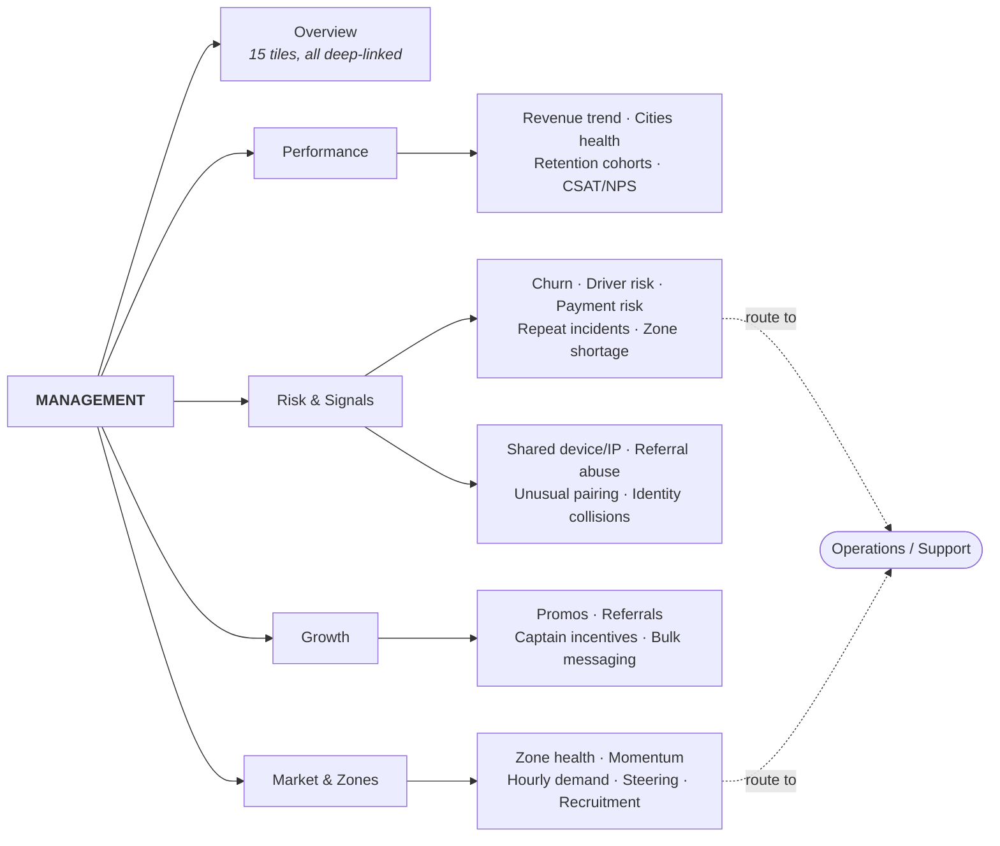
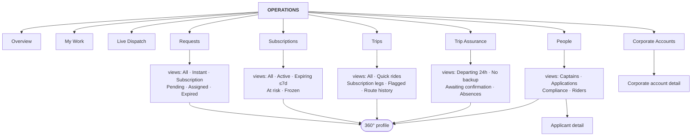
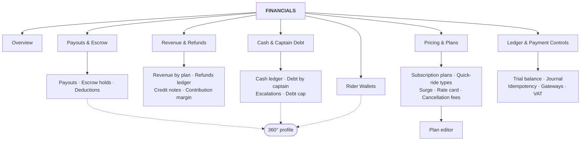
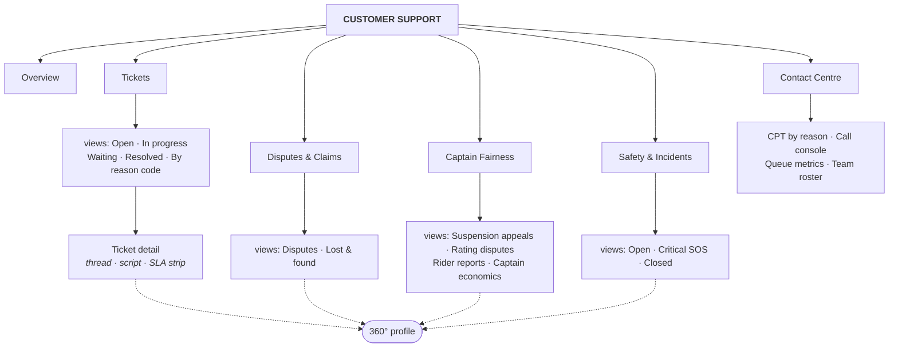
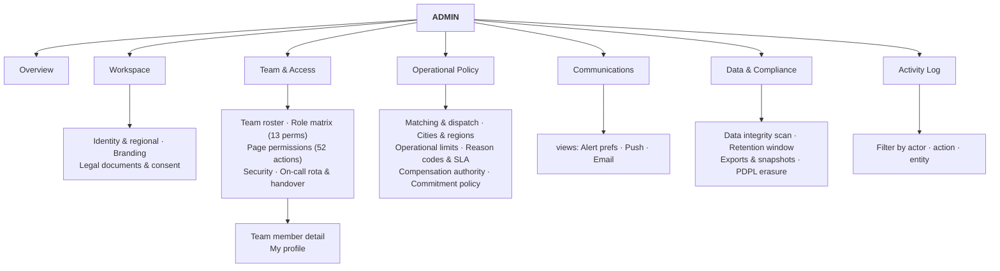

# Proposed Information Architecture

> **Author:** Head of Operations / Business Owner
> **Audience:** founders, engineering lead, ops lead, finance lead
> **Basis:** `docs/00-index/GROUND-TRUTH-INVENTORY.md` (41 pages · 21 settings sub-tabs · 1,042 functions · 355 click handlers), 60 module documents in `docs/01-modules/`, and `docs/04-relations/data/db-usage-matrix.tsv` (1,183 collection↔function edges).
> **Companion documents:** [`PAGE-TRACEABILITY-MATRIX.md`](PAGE-TRACEABILITY-MATRIX.md) (the 41-row audit) · [`MIGRATION-NOTES.md`](MIGRATION-NOTES.md) (sequencing).

---

## 1. Executive summary

Eyvar's operations panel has 41 pages hanging off 9 flat sidebar sections, plus a Settings page holding 21 more sub-tabs. That is **62 distinct destinations in one scrolling list**, and 11 of the 41 pages have no sidebar entry at all — they are reachable only by clicking through from somewhere else, or in one case (`interventions`) only from the browser console.

The list has grown by accretion. It is organised by *how the software was built*, not by *how the business is run*. The clearest evidence is that four separate sidebar sections — Overview, Operations, Fleet, and half of Support — are all worked by the same one or two people during the same shift, while Finance's three pages and Config's 21 settings tabs are opened by a different person once a week.

**What I am proposing:** collapse everything into **5 workspaces** with **34 sub-tabs**, Slack-style, where each workspace corresponds to a job someone is actually paid to do.

| | Today | Proposed |
|---|---|---|
| Top-level groupings | 9 sidebar sections | **5 workspaces** |
| Destinations in the nav | 62 (41 pages + 21 settings tabs) | **34 sub-tabs** |
| Pages with no nav entry | 11 | **0** |
| Maximum navigation depth | 4 (Settings → Email Log → Inbox tab → modal) | **3** (Tab → Sub-tab → Detail) |
| Pages fully retired | — | **1** (`interventions`, already self-declared deprecated) |

**The five workspaces and what changes inside them:**

1. **Management** (5 sub-tabs) — absorbs Executive Overview, Predictive Signals, Fraud & Risk, Promos & Growth and Zones. The two "intelligence" pages become one *Risk & Signals* surface, because neither has a work queue of its own; they are read-and-route screens.
2. **Operations** (9 sub-tabs) — absorbs 21 of the 41 pages. Requests stops being a preview card with two hidden overflow pages; Trip Readiness, Coverage & Capacity and Plan Commitment become one *Trip Assurance* sub-tab because they answer the same question ("will tomorrow's trip actually happen?"); Drivers, All Pending, Applicant Detail and Compliance become one *People* sub-tab.
3. **Financials** (7 sub-tabs) — absorbs Finance, Driver Wallets, Rider Wallets, Pricing Plans, Plan Editor, plus four settings tabs that were never system configuration in the first place (Payment Gateways, Ledger, Pricing & rate card, Cancellation Policy).
4. **Customer Support** (6 sub-tabs) — Support Center splits properly into Tickets / Disputes & Claims / Contact Centre, and gains Captain Fairness and Safety & Incidents, which are case queues with SLA clocks and belong with the people who work case queues 24/7.
5. **Admin** (7 sub-tabs) — the 21 settings tabs collapse to 6 groups plus the Activity Log. Four move out to Financials. General and Branding merge, which incidentally deletes a real defect (two competing logo stores that are never synchronised — `16a` §1).

**Two things that stop being tabs and become part of the shell:** the **360° profile** (`p-profile`) and the **notification centre** (`p-notifications-all`). Neither belongs to a workspace. `riders`, `drivers`, `subscriptions` and `trips` are touched by 112, 112, 86 and 61 distinct functions respectively; they cut across all five workspaces. Making any workspace their owner would be arbitrary. They get an entity-detail layer reachable identically from all five.

**The honest part.** This panel has **zero persistence and zero network calls**. `grep -n "localStorage\|sessionStorage"` returns zero matches across all 21,857 lines; so do `indexedDB`, `document.cookie`, `fetch` and `XHR` (`00b` §9.1, `00d` §4, `03c` §13). Every approval, payout, refund, suspension and settings change is destroyed on refresh. Roughly a third of what looks like functionality is scaffolding: seven of the Finance page's KPI tiles are hardcoded strings that contradict the live table two inches below them; the promo engine has no redemption path; the surge/rate-card system prices nothing; `renderOnCall()` targets a DOM element that does not exist. **This proposal is an information architecture for a rebuild, not a re-skin of the current file.** Section 12 names exactly what must not be carried forward.

---

## 2. Design principles

These are the rules I applied. Where I rejected a rule, I say so and why.

### 2.1 Rules applied

**P1 — A workspace is a job, not a data type.**
The test for a sub-tab is "is there a person whose shift consists mostly of this?" Not "is this a different table?" This is why Drivers, Driver Onboarding and Compliance merge: one person does supply. It is also why Payouts & Escrow and Cash & Driver Debt stay separate: the first is a scheduled disbursement run, the second is a collections and trust problem with its own eight KPIs (`12b` §8.1–8.2).

**P2 — Workspaces own queues and decisions; entities own their records.**
No workspace owns a rider, a driver, a subscription or a trip. The `db-usage-matrix.tsv` makes this non-negotiable: those four collections are touched by 112 / 112 / 86 / 61 distinct functions each, spread across every proposed tab. Each workspace surfaces the *slice* of an entity it needs as a card on the shared 360° profile. See §9.

**P3 — Three levels, hard ceiling: Tab → Sub-tab → Detail.**
A filter or a saved view on an index table is **not** a navigation level — it is a control on the same screen. This is the pattern already sanctioned in `docs/06-design-reference/_partials/06-eyvar-mapping.md` §6.4 ("Index table + view tabs + filters + bulk action bar"). It is what lets Requests hold both instant and subscription requests, and lets People hold captains, applications and compliance, without a fourth level.

**P4 — Overview sub-tabs read; they never act.**
An Overview is where you decide *which* sub-tab to open. Every tile deep-links into the sub-tab that owns the work. This is already half-built: `kpiScrollTo()` has 34 call sites and `go()` has 72. The dashboard's `Open alerts` tile is the counter-example — it is the one tile with no click target (`03a` §17 item 5), and that is exactly the tile people most want to click.

**P5 — Policy lives where it is enforced, not in a settings drawer.**
Cancellation fees, the rate card, payment gateways and the double-entry ledger are money objects. Finance edits them. They move to Financials. This is not a matter of taste — it is what the code already says: 9 of the 11 write actions on Corporate Accounts gate on `manage_subscriptions` (L6518, L6640, L6652, L6716, L6752), and only `commitSendCorpInvoice` gates on `view_finance` (L6703). The permission gates are a better guide to ownership than the sidebar section headings.

**P6 — Nothing is reachable only by accident.**
Eleven pages currently have no nav entry. Four of them are legitimate detail pages (`corp-detail`, `applicant-detail`, `ticket-detail`, `profile`) and become explicit level-3 details. Two are overflow pages that exist only because their parent shows a truncated card (`requests-sub-all`, `requests-instant-all`) and become views. One (`interventions`) is reachable only from the developer console and is retired.

**P7 — If a number is fabricated, it does not get a tile.**
An Overview built on hardcoded figures is worse than no Overview, because it trains people to stop reading. Section 12 lists the 11 fabricated KPI tiles that do not survive.

### 2.2 Rules I considered and rejected

**Rejected: "Intelligence" as a top-level tab.**
Tempting — the current sidebar has one. But predictive signals and fraud flags are *inputs to a decision*, not a place you live. Neither has an owned work queue; both terminate in a `go()` to another page (`02a` §11: every action button is `go('compliance')`, `go('safety')`, `go('zones')`). They belong inside Management as one sub-tab.

**Rejected: merging Coverage & Capacity into the intelligence surface.**
The brief proposed "Predictive + Fraud + Coverage into one intelligence surface." I merged the first two and rejected the third. Coverage & Capacity is not a signal — it is a work queue with two permission-gated write actions (`assignBackup` L13187, `promoteBackup` L13226, both requiring `manage_subscriptions`) and a named daily outcome: every active subscription must have a pre-assigned backup captain. Filing it under intelligence would move a daily ops task into a screen an executive reads weekly. It goes to Operations › Trip Assurance.

**Rejected: a separate "Fleet" workspace.**
Fleet is currently 7 sidebar items. But three of them (Captain Fairness, Coverage, Plan Commitment) are subscription-delivery concerns, one (Safety) is an incident queue, and only Drivers + Compliance are genuinely roster management. A Fleet tab would be a container for four unrelated jobs. Splitting them by *who works them* is the whole point of this exercise.

**Rejected: giving Safety to Operations.**
The brief grouped "Drivers + Driver onboarding + Compliance + Safety". I accepted the first three and rejected Safety. Every safety incident is a coded case with a four-step protocol, an SLA clock and a 24/7 on-call escalation — structurally identical to a ticket, and worked by the same people at 02:00. Its one operational side effect (precautionary suspension) is a driver-record action, reachable from the 360° profile from any workspace. Safety goes to Customer Support.

**Rejected: keeping Settings as a single page with its own left nav.**
It works visually — the Shopify reference sanctions it (§2.4) — but it hides the fact that a third of those 21 tabs are not settings. Payment gateways with live transaction counts is a finance report. The double-entry ledger with a trial balance is a finance control. The rate card with a propose/approve workflow is pricing. Leaving them in a config drawer is why nobody in Finance has ever opened them.

**Rejected: a "Reports" or "Analytics" workspace.**
Every workspace needs its own numbers. A separate reports tab guarantees the numbers drift from the operational screens — which is precisely the defect `16b-settings-data-integrity.md` was written to solve ("a rider profile showed '6 trips · 750.67 SAR paid' in the header and 'no trips on record' two centimetres below it", L18471–18481). Numbers stay next to the work.

---

## 3. The 5 tabs at a glance

| Tab | Purpose | Primary roles | Sub-tabs | Current pages absorbed |
|---|---|---|---:|---:|
| **1. Management** | Performance, trends, risk signals, growth levers and market expansion. Read-and-decide, weekly cadence. | Owner, Ops Manager (read), Finance (read) | 5 | 5 |
| **2. Operations** | The live running of the service — dispatch, trips, subscriptions, requests, supply readiness. Shift cadence. | Ops Manager (primary), Owner, Support (partial) | 9 | 21 |
| **3. Financials** | Money in, money out, reconciliation, pricing. Daily-to-weekly cadence. | Finance (primary), Owner | 7 | 5 pages + 4 settings tabs |
| **4. Customer Support** | Riders, drivers and corporate customers needing help or contesting a decision. 24/7 cadence. | Support (primary), Ops Manager, Owner | 6 | 5 |
| **5. Admin** | Configuration, permissions, communications, data governance, audit. Rare cadence. | Owner (primary), Ops Manager (policy only) | 7 | 3 pages + 17 settings tabs |
| **Shell (not a tab)** | 360° profile · global search · notification centre · my profile | all | — | 3 |
| | | | **34** | **41 / 41** |

> Note on the census: `GROUND-TRUTH-INVENTORY.md` §B states "27 nav items"; the table beneath it lists **30** sidebar links. 41 − 30 = 11, which matches the list of unreachable pages in §B.1. The summary line is wrong by three; the underlying table is right. Corrected here.

---

## 4. Tab 1 — Management

**Who lives here:** the Owner, daily. The Ops Manager and Finance lead, read-only, weekly.
**The question this workspace answers:** *Is the business getting better or worse, and where do I intervene?*

### 4.1 Overview sub-tab — exact widget spec

| # | Widget | What it shows | Current-system source |
|---|---|---|---|
| 1 | **Revenue (paid)** KPI | Σ `DB.payments` where `status==='Paid'` | `exec-overview` KPI 1 — `L6908`, `L6914` |
| 2 | **Active subscriptions** KPI | count of `DB.subscriptions` with `status==='Active'`, delta `n of m total` | `exec-overview` KPI 2 — `L6905`, `L6915` |
| 3 | **Eligible captains** KPI | ⚠ **replaces** exec KPI 3. The current formula `status!=='pending'` is a no-op — no `DB.drivers` record has a `.status` field (`08a` §17 item 2). Use `fleetCounts().eligible` instead. | `fleetCounts()` `L20918–L20943`, surfaced today only on the Drivers page (`supplyKpiHTML()` `L21186`) |
| 4 | **New riders (48h)** KPI | ⚠ **must gain a real time filter.** Today it is `(DB.newRiders||[]).length` with no window despite the label (`01` §17 item 2). | `exec-overview` KPI 4 — `L6917` |
| 5 | **Same-captain kept %** KPI | the core product promise metric | `sameCaptainStats()` `L15697–L15702` |
| 6 | **On-time pickup %** KPI | | `onTimeStats()` `L15703–L15709` |
| 7 | **Daily revenue trend** — two draggable bar charts | 30-day series | `renderTrendChart()` `L6769–L6844` over `DB.dailySnapshots` (30 seeded, `L13802`) |
| 8 | **Contribution margin** card | 10 lines: gross bookings → captain earnings → gross margin → promo spend → referral bonuses → captain incentives → refunds → goodwill → emergency cover → **contribution margin** | `contributionMargin()` `L15718–L15740`, currently buried on the Finance page (`L941–L944`) |
| 9 | **Financial position** card | revenue paid · captain earnings · platform net (est.) · escrow held | `#exec-finance` `L6923–L6928` |
| 10 | **Subscription growth** card | active · expiring soon · cancelled · avg renewal rate | `#exec-sub-growth` `L6932–L6935`. ⚠ The "Avg renewal rate" tile renders **`NaN%`** with shipped seed data — `parseInt('—')` on `rider.stats.renewalRate` (`01` §17 item 1). Fix or drop the tile. |
| 11 | **Cities health** table | per-city drivers / riders / status | `#exec-cities-tbody` `L6937–L6947` over `DB.cities` (4 seeded, `L13946`) |
| 12 | **Open signals** counter | churn + at-risk drivers + payment risk | `predictive` KPI 1 — `L14378` |
| 13 | **Revenue at risk** counter | Σ `subEconomics(s).remaining` for subs scoring < 50 | `predictive` KPI 4 — `L14371–L14373` |
| 14 | **Overdue work right now** counter | cross-queue SLA breaches — the executive's single "are we behind?" number | `work-inbox` KPI 1 — `wi()` `L19115` |
| 15 | **Fraud flags open** counter | shared-IP groups + referral self-abuse + unusual pairings | `fraud` KPIs 1–3 — `L5602`, `L5610–5613`, `L5623–5630` |

Every tile deep-links to the sub-tab that owns it. Tiles 12–15 are the ones that currently exist on four different pages and are never seen together.

### 4.2 Sub-tabs

| Sub-tab | Source pages | Why |
|---|---|---|
| **Overview** | `exec-overview` (KPI strip, financial position, sub growth) | The landing view. Today `exec-overview` is a dead-end read-only page with no click targets on any tile (`01` §4.1: "Tiles are **not** clickable"). It becomes the routing surface. |
| **Performance** | `exec-overview` (trend charts, cities table, expansion list, rider engagement) + `growth` (retention cohorts, CSAT/NPS) | Trends and cohorts are the same question at different time horizons. Cohorts and CSAT are currently stranded at the bottom of a promo page (`11a` cards 5 and 6) where nobody with a P&L ever scrolls. ⚠ Both are **100% hardcoded HTML today** (`11a` §7.4, §7.5) and must be computed or removed. |
| **Risk & Signals** | `predictive` + `fraud` | Both are "compute a flag, then send the operator somewhere else." Every predictive action button is a `go()` to another page (`L14320`, `L14336`, `L14351`, `L14363`). Merging them gives one early-warning surface with five domains (churn, driver availability, payment failure, repeat incidents, zone shortage) plus three fraud domains (shared device/IP, referral self-abuse, unusual pairing) and the identity-collision pre-migration audit. |
| **Growth** | `growth` (promos, referral program, driver incentive rules, bulk messaging) | The four surfaces that spend money to acquire or retain. ⚠ There is **no promo redemption engine anywhere in the file** (`11a` §17 item 1) and `sendBulkMsg` writes nothing (`11a` §17 item 6). This sub-tab is a spec, not a working feature. |
| **Market & Zones** | `zones` + `exec-overview` expansion-ready list | Demand-vs-supply by district, momentum, hourly demand, steering offers and the recruitment queue. The expansion-ready list on the exec page and the supply-starved list on the zones page are two views of one decision. ⚠ `demand` / `supply` / `failures30d` are never computed from live data (`11b` §17 item 2) and zones have no geometry — the "map" is aspirational. |

### 4.3 Structure

---

## 5. Tab 2 — Operations

**Who lives here:** the Ops Manager, all day. Support dips in for Live Dispatch and People. The Owner watches Overview.
**The question this workspace answers:** *Is the service running right now, and what needs a human in the next hour?*

This is the largest workspace by a wide margin: **21 of the 41 pages**. That is correct, not a design failure — it is where the company's work happens.

### 5.1 Overview sub-tab — exact widget spec

| # | Widget | What it shows | Current-system source |
|---|---|---|---|
| 1 | **Subscription trips today** KPI | count over `DB.trips`, delta = active subscriptions | `dashboard` KPI 1 — `L10372` |
| 2 | **Quick rides today** KPI | delta = on-time % today | `dashboard` KPI 2 — `L10373` |
| 3 | **Pending captain approvals** KPI | `DB.pendingDrivers` length | `dashboard` KPI 3 — `L10374` (`L2712`) |
| 4 | **Open alerts** KPI | computed alert queue, delta = critical count. ⚠ Today this is the **one tile with no click target** (`03a` §17 item 5) — it gets one. | `dashboard` KPI 4 — `L10375` |
| 5 | **Eligible captains / available now** KPI | | `dashboard` KPI 5 — `L10376`, `fleetCounts()` `L20918` |
| 6 | **Overdue right now** KPI | cross-queue deadline breaches | `work-inbox` KPI 1 — `L19115` |
| 7 | **Nobody owns** KPI | unclaimed work items across all 12 queues | `work-inbox` KPI 3 — `L19244` |
| 8 | **Money chip** | today's take, live | `#dash-money-line` `L679` |
| 9 | **Needs intervention now** feed | live requests + red-readiness upcoming trips | `buildInterventionItems()` `L9450–L9533` |
| 10 | **Today's subscription trips** table | | `renderDashboard()` `L10346`, `#dash-sub-tbody` |
| 11 | **Today's quick rides** table | | `#dash-qr-tbody` |
| 12 | **Alert queue** | late trips, deductions, expiring subs, cancellation caps | `renderDashboard()` `L10360–L10367` |
| 13 | **Renewal pipeline preview** (4 rows) | | `#dash-renewals` `L10434` |
| 14 | **Readiness counters** | total · unconfirmed · not moving · driver unavailable | `readiness` — `#rd-total`, `#rd-unconf`, `#rd-notmoving`, `#rd-unavail` (`L870`) |
| 15 | **Request SLA breaches** | instant requests in `no_drivers` | `renderRequestsPage()` `L10071`, `sbb-requests` `L10118` |

⚠ Two counters currently disagree and must be reconciled before this Overview ships: `#dash-intervene-count` uses `buildInterventionItems()` with a 60-minute cut-off, while the standalone interventions page uses the unfiltered builder (`03a` §17 item 2).

### 5.2 Sub-tabs

| Sub-tab | Source pages | Views (not levels) | Why |
|---|---|---|---|
| **Overview** | `dashboard` | — | The shift-start board. Merges the dashboard's five counters with the work-inbox's two ownership counters, which today live on different screens. |
| **My Work** | `inbox` | Mine · Unassigned · Everything | The deadline-ordered router over 12 queues. Kept separate from Overview because Overview is read and My Work is worked. ⚠ Fix `WORK_ROUTING`: it routes 11 of 12 queues to a role called `'Operations'` that **does not exist** in `TEAM_ROLES` (`03b` §17 item 1). |
| **Live Dispatch** | `live` (live mode) + `interventions` (the surviving "Live trip interventions" card) | — | Map + the three-feed dispatch board (active trips, sub trip requests, ride requests). The interventions page's own body copy says it was merged into the work inbox; its one surviving card is trip-level and belongs next to the map. |
| **Requests** | `requests` + `requests-sub-all` + `requests-instant-all` | All · Instant · Subscription · Pending · Assigned · Expired | **The clearest artificial split in the panel.** Requests shows two truncated preview cards; the full lists are two separate pages with no nav entry, each with its own search box, pager and "← Back to requests" button. One index with view tabs replaces three pages and removes a navigation level. |
| **Subscriptions** | `subscriptions` + `renewal` | All · Active · Expiring ≤7d · At risk · Frozen | Renewal Pipeline is a date filter on the subscription list plus a health score. It is `DB.subscriptions` filtered to `ends` within 7 days of `EYVAR_TODAY` (`L11232`) scored by `subHealthScore()` (`L14210`). That is a saved view, not a page. |
| **Corporate Accounts** | `corporate` + `corp-detail` | — | Own sub-tab, not a view of Subscriptions, because companies are a different entity with their own detail page. Placed in Operations rather than Financials on the evidence of the permission gates: 5 of 6 write actions require `manage_subscriptions`; only invoice-sending requires `view_finance`. |
| **Trips** | `trips` + `quickrides` + `live` (history mode) | All · Quick rides · Subscription legs · Flagged · Low rating · Route history | Quick Rides is `DB.trips` filtered to `kind==='Quick ride'` — the same table with a different filter. Its four KPI tiles are **entirely hardcoded** (`06b` §17 item 1) and its "today" claim is false (no date filter is applied, `L3443`). Route history is a replay control over the same trip records; it belongs with trips, not with live dispatch. |
| **Trip Assurance** | `readiness` + `coverage` + `commitment` | Departing next 24h · No backup captain · Awaiting confirmation · Absences | **The most consequential merge in this proposal.** All three answer one question: *will tomorrow's subscription trip actually happen?* Readiness watches the next few hours (driver available? moving? rider confirmed?). Coverage watches structural exposure (does this subscription have a backup captain?). Commitment watches the captain's nightly confirmation and the absence counter. They share `DB.upcomingSubTrips` (27 functions), `DB.subBackups`/`backupRegistry`, `DB.planConfirmations` and `DB.absenceEvents` (16 functions) — and today an operator has to open three pages to assemble one picture of one trip. |
| **People** | `drivers` + `all-pending` + `applicant-detail` + `compliance` + `riders` | Captains · Applications · Compliance · Riders | Onboarding is the front of the captain lifecycle and compliance is the back of it; both write to the same record. The evidence that the split is harmful: `DRV-0106` exists on the roster but has **no `DB.driverDocs` entry**, so it is invisible to `complianceScan()` and can never be auto-suspended for an expired document (`08a` §17 item 9). Two pages, two data sets, one entity, one gap nobody sees. Riders joins as a fourth view because it is the same shape of screen (roster + risk filter + drill-down to 360°). |

### 5.3 Structure

---

## 6. Tab 3 — Financials

**Who lives here:** the Finance lead, daily. The Owner, weekly. Nobody else, by default.
**The question this workspace answers:** *What did we take, what do we owe, and do the books agree?*

### 6.1 Overview sub-tab — exact widget spec

| # | Widget | What it shows | Current-system source |
|---|---|---|---|
| 1 | **Contribution margin** card | the 10-line waterfall: gross bookings · captain earnings · **gross margin** · promo spend · referral bonuses · captain incentives · refunds · goodwill credits · emergency cover · **contribution margin** | `contributionMargin()` `L15718–L15740` — the only genuinely live money summary on the current Finance page |
| 2 | **Available now** KPI | captain balances payable | `#avail-now-kpi` (`12b` §8.1, `L975`) |
| 3 | **Held in escrow** KPI | subscription money not yet earned | `#escrow-held-kpi` |
| 4 | **Ready to release** KPI | escrow where the trip count is met | `#escrow-ready-kpi` |
| 5 | **Pending deductions** KPI | | `#deduct-kpi` |
| 6 | **Total captain debt outstanding** KPI | cash collected but not remitted | `#cash-debt-kpi` (`12b` §8.2, `L1003`) |
| 7 | **Captains over debt cap** KPI | cash collection suspended | `#cash-blocked-kpi` |
| 8 | **Rider wallet liability** KPI | total balance held · riders with a balance · wallet transactions | `rwallets` KPIs 1–3 |
| 9 | **Refunds this period** | count + total | `#refunds-total` `L3207` over `DB.refunds` |
| 10 | **Credit notes issued** | VAT reversal status, unlinked count | `renderCreditNotes()` `L15921–L15932` |
| 11 | **Trial balance** strip | 12-row chart of accounts, balanced/unbalanced | `trialBalance()` / `renderLedger()` `L20069` |
| 12 | **Revenue by plan** table | | `#finance-revenue-table` `L949–L960` — ⚠ **currently hardcoded** and it contradicts the KPI above it (KPI says Eyvar net `9,246` / `19.2%`, the table total says `8,752` / `18.1%` — `12a` §17 R12). One of them must go. |

**Dropped from this Overview:** the seven hardcoded KPI tiles at `L930–L940` (`Gross revenue (Jun)`, `Eyvar net (Jun)`, `Driver payouts`, `Pending payouts`, `Held in subscription escrow`, `Ready to release`, `Deductions (Jun)`). All seven are string literals. Three of them have live equivalents already computed on the Wallets page. Showing a fabricated June figure above a live table is how a finance function loses trust in its own dashboard.

### 6.2 Sub-tabs

| Sub-tab | Source | Why |
|---|---|---|
| **Overview** | `finance` KPI strip (rebuilt live) + `wallets` KPI strips + `rwallets` KPIs + ledger trial balance | One money picture. Today it takes three pages plus a settings tab to assemble it. |
| **Revenue & Refunds** | `finance` (revenue by plan, refunds ledger, credit notes, contribution margin detail) | What we billed and what we handed back. ⚠ Carries five documented money defects — see §12. |
| **Payouts & Escrow** | `wallets` (quick-ride payouts, subscription escrow, deductions) | The disbursement run. Three linked subsystems: earn → hold → release, minus penalties. |
| **Cash & Captain Debt** | `wallets` (cash reconciliation) | Kept separate from Payouts. It is a collections problem with its own four KPIs, its own escalation path to Trust & Safety, and a hard debt cap that suspends cash collection. Different work, different rhythm, arguably a different person. ⚠ The header promises "auto-deducted from the next payout" and **no such deduction is implemented** (`12b` §17 R16). |
| **Rider Wallets** | `rwallets` + the goodwill ledger | The rider-side liability account. Credits from refunds, goodwill and referral bonuses land here instead of a bank transfer. |
| **Pricing & Plans** | `plans` + `plan-edit` + Settings › `pricing` (rate card, surge suspensions) + Settings › `cancelpolicy` | **Four disjoint pricing models coexist today** (`14a` §19 item 1): `DB.plans` (this page), `PLANS`/`CADENCE_META`/`CADENCE_DAYS` (the new-sub and renewal flows), `DB.quickRideTypes` + `DB.surgeSchedule`, and `DB.rateCard` (Settings). Nothing outside the pricing module reads `DB.rateCard` — no trip, quote or invoice in the panel is priced from it. Putting all four on one sub-tab is the only way the contradiction becomes visible enough to fix. |
| **Ledger & Payment Controls** | Settings › `ledger` + Settings › `gateways` + VAT/invoice config | Double-entry postings, idempotency keys, and the six payment methods with live transaction counts. ⚠ `enabled` and `isDefault` on gateways are **write-only** — no charge path reads them (`15h` §11 item 1). ⚠ The ledger's `⛔ OUT OF BALANCE` state is unreachable because `postLedger` refuses every unbalanced posting (`16h` §12 item 3). |

### 6.3 Structure

---

## 7. Tab 4 — Customer Support

**Who lives here:** Support agents, 24/7. The Ops Manager for escalations. Trust & Safety (a role that does not exist yet — see §10.4).
**The question this workspace answers:** *Who needs help, who is contesting something, and are we keeping the promises we made them?*

### 7.1 Overview sub-tab — exact widget spec

| # | Widget | What it shows | Current-system source |
|---|---|---|---|
| 1 | **Open tickets** KPI | | `#tk-open` (`support`, `L1360`) |
| 2 | **In progress / Resolved** KPIs | | `#tk-prog`, `#tk-res` |
| 3 | **Breaching now** KPI | SLA clocks past target across all coded contacts | `contacts` KPI 2 — `renderContactsPage()` `L15019–L15027` |
| 4 | **Promise kept %** KPI | contacts resolved inside SLA | `contacts` KPI 3 |
| 5 | **Contacts per 1,000 trips (CPT)** KPI | the volume-as-product-signal metric | `contacts` KPI 1 |
| 6 | **Uncoded contacts** KPI | contacts with no reason code — the data-quality gauge | `contacts` KPI 4 |
| 7 | **Queue metrics** strip | Calls · AHT · ASA · answered within target · abandoned · unrecognised callers | `renderQueueMetrics()` `L20339–L20346` |
| 8 | **Open safety incidents / Critical SOS** KPIs | | `safety` KPIs 1–2 — `L13400–L13401` |
| 9 | **Precautionary suspensions** KPI | captains currently out of dispatch on safety grounds | `safety` KPI 4 — `L13404` |
| 10 | **Open fairness cases / Overturn rate** KPIs | captain appeals and how often we were wrong | `fairness` KPIs 1–2 — `L15669–15674` |
| 11 | **Open disputes / Lost & found in flight** | | `renderDisputes()` `L14397`, `renderLostFound()` `L14454` |
| 12 | **Top contact reasons** table (top 5) | reason code · CPT · SLA exposure · **root-cause owner** | `contacts` — the "read this top-down" table (`L15043`) |
| 13 | **On call now** chip | who is reachable this shift, and the next gap | `onCallNow()` / `rotaGaps()` `L19634` |
| 14 | **CSAT / NPS** | ⚠ **currently a fully hardcoded HTML string** (`11a` §7.5) with no survey trigger on ticket close. Include only once wired. | `renderCsat()` `L13786–L13796` |

Widget 12 is the one an executive should read: the current page's own instruction is *"the top row is the contact you should be trying to eliminate, and the owner column says whose backlog that fix belongs in. Support volume is a product signal, not a staffing input."* (`L15043`). Today it is buried on a page with no sidebar entry.

### 7.2 Sub-tabs

| Sub-tab | Source | Why |
|---|---|---|
| **Overview** | assembled from `support`, `contacts`, `safety`, `fairness` | Four queues, one health read. |
| **Tickets** | `support` (tickets card) + `ticket-detail` | The ticket queue, sorted by SLA urgency rather than date (`L2341`), with the 40-code reason taxonomy, the Call Center Guide script, and the conversation thread on a detail page. |
| **Disputes & Claims** | `support` (disputes card + lost & found card) | Money claims resolved evidence-first (including the GPS arrival verdict from `arrivalEvidence()` `L17643`), plus the three-state lost-item workflow. Both are claim-shaped: something happened, evidence is weighed, an outcome with a financial effect is recorded. ⚠ **Neither can be created from the UI** — `DB.disputes` and `DB.lostFound` are seed-only (`13b` §17 items 1–2). |
| **Captain Fairness** | `fairness` | Suspension appeals, rating disputes, captain-reported rider issues, plus the captain-economics table (earnings per engaged hour). Placed in Support, not Fleet, because the source is explicit that every case is a coded ticket counting in CPT reporting (`L15504`, `logContact` at `L15516`). In a subscription model a captain locked to one rider loses a full week's income to one unfair report — this queue is the supply side's customer support. |
| **Safety & Incidents** | `safety` | SOS and reported incidents under a fixed four-step protocol (contact → verify → act → document) that must complete before closure, plus one-click precautionary suspension. ⚠ **No incident can be created** and **no closed incident can be reopened**, despite the confirm text promising both (`10e` §17 items 2–3). ⚠ **No way to lift a precautionary suspension.** |
| **Contact Centre** | `contacts` + `support` (support team card) | CPT-by-reason-code analytics with named root-cause owners, the call console (screen-pop, timer, wrap-up coding), queue metrics, and the support team roster with per-agent load. ⚠ There is no CTI and no WhatsApp API; the integration points `onIncomingCall()` and `onInboundMessage()` are defined and named but nothing calls them from outside. The panel is honest about this (`L20155–L20170`); the rebuild must be too. |

### 7.3 Structure

---

## 8. Tab 5 — Admin

**Who lives here:** the Owner. The Ops Manager, for Operational Policy only.
**The question this workspace answers:** *How is this system configured, who can do what, and what happened?*

The 21 settings sub-tabs collapse to **6 groups plus the Activity Log**. Four tabs leave for Financials. Two merge into one (General + Branding).

### 8.1 Overview sub-tab — exact widget spec

| # | Widget | What it shows | Current-system source |
|---|---|---|---|
| 1 | **Config changes (7d)** KPI | count of `config_updated` audit entries — the single highest-volume action key in the file, 40 call sites | `DB.auditLog` via `logAction()` `L3133` |
| 2 | **Aggregate drift** KPI | entities where a stored total disagrees with the records behind it | `renderIntegrity()` `L18576`, capped at 40 rows |
| 3 | **Team** KPI | active · invited · **2FA off** (2 of 5 seeded users have 2FA on) | `DB.teamUsers` `L2830–L2841` |
| 4 | **Permission concentration** warning | ⚠ 39 of 131 permission guards (30%) resolve to `manage_settings`, held by **one** user. Bus factor 1. | `00c` §5.2 |
| 5 | **Unenforced permissions** warning | `view_profiles` is granted to all 5 users and enforced at **zero** call sites; 19 of 41 pages have no `PAGE_PERMISSIONS` entry at all | `00c` §5.1, §5.2 |
| 6 | **On-call coverage gaps** | uncovered slots out of 42 (7 days × 3 shifts × 2 tiers), night and weekend gaps first | `rotaGaps()` `L19634` |
| 7 | **Legal consent compliance** | % of riders/drivers on the current version of each of 3 documents (8 versions total) | `DB.legalDocuments` `L13867`, `renderLegalConsent()` `L3801` |
| 8 | **PDPL erasure queue** | open erasure requests | `renderErasureQueue()` `L16045` |
| 9 | **Data retention window** | months of operational data in scope (currently 13) | `DB.dataWindow` `L20403` |
| 10 | **Export activity (30d)** | who pulled what data. ⚠ **No export in the panel is permission-gated** — a Support user with 3 permissions can export the full payments table and the entire audit log (`00c` §5.4). | `export_data` audit entries |
| 11 | **Unlabelled audit actions** | 135 of 161 distinct action keys (84%) have no label and cannot be filtered in the Activity Log — including `impersonation_started`, `account_suspended`, `erasure_executed` | `00c` §5.3 |

Items 4, 5, 10 and 11 are not decoration. They are the four governance failures the documentation found, and putting them on the Admin landing page is how they stop being invisible.

### 8.2 Sub-tabs — the 21 → 7 collapse

| # | Sub-tab | Absorbs (current settings tab keys) | Why |
|---|---|---|---|
| 1 | **Overview** | — | New. See §8.1. |
| 2 | **Workspace** | `general` + `branding` + `legal` | General and Branding are **the same feature implemented twice**: two independent logo stores that are never synchronised (`DB.branding.logoUrl` drives the sidebar; `DB.opsConfig.general.logoDataUrl` drives the favicon — `16a` §1). Merging them deletes the defect. Legal & consent joins because it is company identity of a different kind: which terms version each user agreed to. |
| 3 | **Team & Access** | `team` + `permissions` + `security` + `rota` + (`my-account` page) | `renderTeamTable()` already calls both permission matrices (`L10465–L10466`), so the Team and Permissions tabs never render independently — they are one screen pretending to be two. Security (session timeout, 2FA policy) is access control. On-call rota and handover is who can be reached, which is the same question at a different granularity. |
| 4 | **Operational Policy** | `dispatch` + `cities` + `limits` + `reasons` (incl. SLA, compensation authority, commitment policy) | The parameters an **Ops Manager** should be able to change without an Owner. Today all of them require `manage_settings`, which only the Owner holds — so tuning the dispatch radius during a supply shortage requires the founder. That is an operational cost, not a security control. |
| 5 | **Communications** | `notifications` (alert preferences) + `push` + `emails` | One place for every outbound and internal channel. The Email Log's Inbox/Outbox split becomes views on one index, removing the panel's only 4-level path. ⚠ The email and push audience lists are **out of sync** — 9 options vs 11, different keys for "all riders" (`16d` §11 item 7). |
| 6 | **Data & Compliance** | `integrity` + `export` (incl. daily snapshots) + PDPL erasure queue + data retention window | Governance. Where a stored total disagrees with its records; what data leaves the building and who took it; what we are legally required to delete. ⚠ `rebuildAllHistory()` — which writes hundreds of records — has **no permission gate** (`16b` §12 item 1). |
| 7 | **Activity Log** | `activity` + the `audit-log` page | One audit surface, not a 4-row preview plus a page. ⚠ The current preview's description says "Every configuration change made in Settings"; it actually shows the four newest entries of the **global** log with no filter (`16j` §12 item 1). |

**Moved out of Admin:** `gateways`, `ledger`, `pricing` (rate card), `cancelpolicy` → **Financials**. These are money objects with money owners. See §2.1 P5.

### 8.3 Structure

---

## 9. Cross-cutting: the 360° profile, global search, notifications

### 9.1 The entity problem, stated plainly

`docs/04-relations/data/db-usage-matrix.tsv` settles the argument about who owns what:

| Collection | Distinct functions touching it | Appears in which proposed tab? |
|---|---:|---|
| `riders` | **112** | all 5 |
| `drivers` | **112** | all 5 |
| `subscriptions` | **86** | Management, Operations, Financials, Support |
| `trips` | **61** | Management, Operations, Financials, Support |
| `teamUsers` | **56** | Admin, plus every gated action everywhere |
| `commitPolicy` | 36 | Operations, Admin |
| `upcomingSubTrips` | 27 | Operations |
| `tickets` | 25 | Support, Operations |
| `opsConfig` | 24 | Admin, Operations |

Four business entities are touched by 61–112 functions each and appear in every workspace. **No tab can own them.** Any structure that tries produces the same failure the current one has: a rider's wallet is in Finance, their subscription is in Operations, their tickets are in Support, their churn score is in Intelligence, and nobody can see the customer.

### 9.2 The mechanism: one profile shell, reached identically from everywhere

The current system already has the right answer and under-uses it. `p-profile` is a single shared shell driven by `openProfile(id, isBack)` (`L8827`), with `resolveId()` (`L3266`) dispatching to one of six `DB` buckets. **`openProfile` has 100 call sites — the second-most-used handler in the entire panel after `closeModal`.** It is already the universal drill-down target; it is just filed as if it were a page.

**Where it lives:** nowhere in the tab rail. It is a **detail layer** that opens over whichever workspace you are in, as a right-side drawer with an "open full page" escape for deep review. The workspace stays visible behind it, and the back-stack is scoped to the workspace so switching tabs does not lose your place.

**How it is reached from all five tabs — identically:**

| Entry point | Current implementation | Present in |
|---|---|---|
| Global search (⌘K / topbar) | `globalSearch(raw)` `L3277` → `resolveId` → `openProfile` | shell, every page |
| Any id or name link in any table | `rowLink(id,label)` `L3283` — the monospace blue link used in dozens of tables | every index |
| Any KPI row drill-down | direct `openProfile(...)` — 100 call sites | every workspace |
| Any notification | `handleNotifClick(id)` `L2273` | shell |
| Any work-inbox row | `inboxOpen(type,id)` `L19301` | Operations › My Work |

**What must change:**

1. **Extend the resolver from 6 entity types to 11.** Today `resolveId` covers `riders`, `drivers`, `trips`, `subscriptions`, `payments`, `complaints`. It does **not** cover `newRiders`, `pendingDrivers`, `tickets`, `corporateAccounts` or `plans` — so typing `TKT-505`, `APP-2201` or `CORP-001` into global search returns *"No record found"* while those entities have perfectly good detail pages elsewhere (`09b` §17 item 2). Five separate detail screens (`applicant-detail`, `ticket-detail`, `corp-detail`, `plan-edit`, `openNewRiderProfile`) become five more profile variants behind one shell.
2. **Fix first-match-wins name search.** `resolveId`'s name search is an unordered `for…in` returning the first substring hit, over riders and drivers only (`09b` §17 item 1). Searching "Al-Harbi" silently picks one of two people. It needs a disambiguation list, phone-number search and partial-id matching.
3. **Sections, not pages.** Each workspace contributes cards to the profile: Financials contributes the wallet and payment cards, Support contributes tickets/disputes/fairness, Operations contributes trips/subscriptions/compliance/commitment. The rider variant already stacks 12–15 cards this way — the model is proven; it just needs to be a declared contract instead of one 600-line builder.
4. **Collapse controls for every type.** `initCardToggles()` runs for riders and drivers only (`09b` §17 item 4); the other four types get an uncollapsible wall.

### 9.3 Global search

Promote the topbar `#global-search` from a single-entity id lookup to the primary cross-workspace navigator: entities, sub-tabs, and actions. It is the escape hatch that makes a 5-tab structure survivable — if someone cannot find Cancellation Policy, search takes them to *Financials › Pricing & Plans › Cancellation fees* without them needing to know it moved out of Settings.

### 9.4 Notifications

`notifications-all` stops being a page (page 20 of 41, no sidebar entry) and becomes the **expanded state of the topbar bell panel**. The design is already right — triaged by priority, never by recency alone (`L2175–2187`), four tiers, six filter chips. It just should not be competing with Subscriptions for a slot in the nav.

Three defects to fix on the way: `alert` — by far the most common runtime type, with 16 producers — has **no click destination** in `handleNotifClick`, so the most frequent notification does nothing when clicked (`03c` §17). The `renewal`, `approval` and `complaint` types have full icon/priority/routing support and **no runtime producer**. And every read flag reverts on reload, so the badge returns to 3.

### 9.5 My profile

`my-account` stops being a page and becomes a drawer from the avatar: profile, password, 2FA, active sessions, and "exactly what your role can do" (the 13-permission summary at `renderMaPermissions()` `L3065`). The last of those is genuinely valuable and should stay — it is the only place an operator can see their own effective permissions.

---

## 10. Role → tab visibility matrix

### 10.1 The roles that exist today

`var TEAM_ROLES = ['Owner','Ops Manager','Finance','Support']` (`L10501`), with 5 seeded users:

| Role | Users | Broad permissions held (of 13) |
|---|---|---|
| Owner | Sarah Al-Rashid (`USR-1`) | **13** — all |
| Ops Manager | Yousef Al-Balawi (`USR-5`) | **8** — approve_drivers, manage_subscriptions, live_ops, manage_plans, view_finance, manage_tickets, view_profiles, contact_users |
| Finance | Fahad Al-Dosari (`USR-2`) | **5** — process_payouts, release_escrow, apply_deductions, view_finance, view_profiles |
| Support | Lina Al-Otaibi (`USR-3`), Noura Al-Fahad (`USR-4`, *Invited*) | **3** — manage_tickets, view_profiles, contact_users |

### 10.2 Default landing tab

| Role | Lands on | Rationale |
|---|---|---|
| Owner | **Management › Overview** | The only role whose job is the whole business. |
| Ops Manager | **Operations › Overview** | Replaces `dashboard` as the shift-start screen. |
| Finance | **Financials › Overview** | Today Finance lands on the dashboard, which contains nothing they can act on. |
| Support | **Customer Support › Overview** | Today Support lands on the dashboard and has to find Support Center in a 30-item sidebar. |

### 10.3 Visibility matrix

**Legend:** ● full · ◐ read-only · ○ hidden by default (grantable) · — not applicable

| Sub-tab | Owner | Ops Manager | Finance | Support |
|---|:--:|:--:|:--:|:--:|
| **MANAGEMENT** | | | | |
| Overview | ● | ◐ | ◐ | ○ |
| Performance | ● | ◐ | ◐ | ○ |
| Risk & Signals | ● | ● | ◐ | ○ |
| Growth | ● | ● | ◐ | ○ |
| Market & Zones | ● | ● | ○ | ○ |
| **OPERATIONS** | | | | |
| Overview | ● | ● | ○ | ◐ |
| My Work | ● | ● | ◐ | ● |
| Live Dispatch | ● | ● | ○ | ◐ |
| Requests | ● | ● | ○ | ◐ |
| Subscriptions | ● | ● | ◐ | ◐ |
| Corporate Accounts | ● | ● | ◐ | ○ |
| Trips | ● | ● | ◐ | ◐ |
| Trip Assurance | ● | ● | ○ | ◐ |
| People | ● | ● | ◐ | ◐ |
| **FINANCIALS** | | | | |
| Overview | ● | ◐ | ● | ○ |
| Revenue & Refunds | ● | ◐ | ● | ○ |
| Payouts & Escrow | ● | ○ | ● | ○ |
| Cash & Captain Debt | ● | ◐ | ● | ○ |
| Rider Wallets | ● | ◐ | ● | ◐ * |
| Pricing & Plans | ● | ● | ● | ○ |
| Ledger & Payment Controls | ● | ○ | ● | ○ |
| **CUSTOMER SUPPORT** | | | | |
| Overview | ● | ● | ○ | ● |
| Tickets | ● | ● | ○ | ● |
| Disputes & Claims | ● | ● | ◐ | ● |
| Captain Fairness | ● | ● | ○ | ● |
| Safety & Incidents | ● | ● | ○ | ● |
| Contact Centre | ● | ● | ○ | ● |
| **ADMIN** | | | | |
| Overview | ● | ◐ | ○ | ○ |
| Workspace | ● | ○ | ○ | ○ |
| Team & Access | ● | ○ | ○ | ○ |
| Operational Policy | ● | ● † | ○ | ○ |
| Communications | ● | ◐ | ○ | ○ |
| Data & Compliance | ● | ◐ | ◐ | ○ |
| Activity Log | ● | ◐ | ◐ | ◐ |

**\*** Support gets write access to rider wallet credits **only within their compensation authority limit** — the `compPolicy` per-role cap already exists (`DB.compPolicy`, `L15379`, 5 roles). This is the one money action a support agent legitimately needs mid-call, and it is already policy-bounded.

**†** Operational Policy is the deliberate exception to "Admin is Owner-only". See §10.5.

### 10.4 Roles that should be added

| Proposed role | Why | Default tabs |
|---|---|---|
| **Trust & Safety** | Safety incidents, fraud flags, captain suspensions and cash-debt escalations are currently handled by whoever is nearest. They need one owner with suspension authority but no financial or configuration access. | Customer Support (●), Management › Risk & Signals (●), Operations › People (◐) |
| **Dispatcher** | A shift role narrower than Ops Manager: Live Dispatch, Requests, Trip Assurance. No pricing, no plan editing, no approvals. | Operations (● on 5 of 9 sub-tabs), everything else hidden |

### 10.5 Two permission problems this structure exposes

**Problem 1 — `manage_settings` is a bus factor of one.** 39 of the 131 `requirePerm()` guards (30%) resolve to `manage_settings`, held only by `USR-1`. That single key gates cities, gateways, dispatch radius, security policy, branding, legal versions, the data-retention window, reason codes, SLA policy, the on-call rota, and **GDPR/PDPL erasure execution**. If the Owner is on a plane, nobody can widen the dispatch radius during a supply crisis. **Recommendation:** split `manage_settings` into `manage_ops_policy` (dispatch, cities, limits, reason codes, SLA, commitment — grant to Ops Manager), `manage_workspace` (branding, general, legal, communications — Owner) and `manage_data_governance` (retention, erasure, integrity, exports — Owner + a named DPO).

**Problem 2 — the permission matrix does not know about half the product.** `PAGE_PERMISSIONS` covers **22 of 41 pages**; 19 have no entry at all, including `fraud`, `rwallets` (money), `corp-detail` (corporate billing), `profile` (all PII), `applicant-detail` (KYC documents) and `contacts`. An administrator reading the permissions screen cannot even see that those surfaces exist. And `view_profiles` — the permission that ought to gate every one of those 100 `openProfile` call sites — is enforced at **zero** call sites. **Recommendation:** the new structure has 34 sub-tabs; every one gets an entry, and `view_profiles` becomes a real gate on the profile drawer.

---

## 11. Navigation depth check

**The rule:** Tab → Sub-tab → Detail. Three levels, hard ceiling. Filters, saved views and index view-tabs are controls on a screen, not levels (see §2.1 P3).

### 11.1 Current 4-level paths and their fix

| # | Current path (4 levels) | Depth | Redesign | New depth |
|---|---|:--:|---|:--:|
| 1 | Config → Settings → **Email Log** tab → **Inbox/Outbox** sub-tab → preview modal | 4 | Admin → Communications → *view: Email · Inbox / Outbox* → detail | **3** |
| 2 | Config → Settings → **Pricing Plan** page → **Plans / Quick Rides** sub-tab → Edit plan | 4 | Financials → Pricing & Plans → *view: Subscription plans / Quick rides* → Plan editor | **3** |
| 3 | Operations → **Requests** → *requests-sub-all* (separate page) → 360° profile | 4 | Operations → Requests → *view: Subscription* → 360° profile | **3** |
| 4 | Operations → **Requests** → *requests-instant-all* (separate page) → 360° profile | 4 | Operations → Requests → *view: Instant* → 360° profile | **3** |
| 5 | Fleet → **Drivers** → *all-pending* (separate page) → **applicant-detail** → document zoom modal | 5 | Operations → People → *view: Applications* → Applicant detail (modal = overlay, not a level) | **3** |
| 6 | Operations → **Corporate accounts** → *corp-detail* → employee → 360° profile | 4 | Operations → Corporate Accounts → Account detail → *(profile opens as a drawer over it, not beneath it)* | **3** |
| 7 | Config → Settings → **Permissions** tab → expand a page row → per-action checkboxes | 4 | Admin → Team & Access → *(matrix expands inline; expansion is not navigation)* | **2** |
| 8 | Support → **Support Center** → *ticket-detail* → linked trip → 360° profile | 4 | Customer Support → Tickets → Ticket detail → *(profile opens as a drawer)* | **3** |

### 11.2 Every proposed path proven ≤ 3

| Destination class | Path | Levels |
|---|---|:--:|
| Any workspace landing | Tab → Overview | 2 |
| Any index | Tab → Sub-tab | 2 |
| Any filtered index | Tab → Sub-tab *(+ view)* | 2 |
| Any entity record | Tab → Sub-tab → 360° drawer | 3 |
| Applicant KYC review | Operations → People *(Applications)* → Applicant detail | 3 |
| Ticket conversation | Customer Support → Tickets → Ticket detail | 3 |
| Corporate account | Operations → Corporate Accounts → Account detail | 3 |
| Plan editing | Financials → Pricing & Plans *(Subscription plans)* → Plan editor | 3 |
| Any setting | Admin → Sub-tab *(+ card)* | 2 |
| Audit entry actor history | Admin → Activity Log → *(modal)* | 2 + overlay |
| Profile reached from global search | *(any tab)* → 360° drawer | current + 1 |

**The rule that makes this hold:** the 360° profile is a *drawer over the current screen*, not a page beneath it. Opening a rider from a ticket does not push a fourth level — it overlays the third. This is also why the back-stack (`navStack`, capped at 40, `L7006`) stops being load-bearing: today the only way back from a profile is a history pop, and `navStack` overflow silently drops the oldest entry (`09b` §17 item 7).

---

## 12. What I am retiring, and why

### 12.1 Pages retired outright

| Page | Reason |
|---|---|
| `interventions` (`p-interventions`, `L2068`) | **The page retires itself.** Its own body copy (`L2071–L2072`) reads: *"This page ran the same builder as the dashboard widget and rendered the same rows in two places — and at 59 items neither was a list anyone could work. That job now belongs to the work inbox."* There is no sidebar entry, no `go('interventions')` call anywhere in 21,857 lines, and no URL router — the page is reachable **only from the developer console**. Its one surviving card ("Live trip interventions") moves to Operations › Live Dispatch, where trip-level actions belong. |

**That is one page out of 41.** I want to be straight about why the retirement list is short: the pages in this panel are, with that single exception, legitimate work surfaces with broken implementations. The waste is not at the page level — it is at the component level, and that list is long.

### 12.2 Components retired — do not carry these into the rebuild

**Fabricated numbers (11 tiles + 4 cards)**

| Item | Location | Why it goes |
|---|---|---|
| 7 hardcoded Finance KPI tiles | `finance` `L930–L940` | String literals. KPI 2 says Eyvar net `9,246` / `19.2%`; the table 10 rows below says `8,752` / `18.1%` (`12a` §17 R12). |
| 4 hardcoded Quick Rides KPI tiles | `quickrides` `L1135–L1138` | Numbers, deltas *and bar widths* all hardcoded, sitting above a live table (`06b` §17 item 1). Live equivalents already exist for three of them. |
| Retention cohorts card | `growth` `L13762` | Never reads `DB.subscriptions` (`11a` §17 item 9). |
| CSAT / NPS card | `growth` `L13786` | A static HTML string. No survey trigger on ticket close or package end (`11a` §17 item 8). |
| Revenue-by-plan table | `finance` `L949–L960` | Hardcoded demo figures presented as a report. |
| "Avg renewal rate" tile | `exec-overview` `L6935` | Renders **`NaN%`** with shipped seed data (`01` §17 item 1). |

**Dead code and orphaned surfaces**

| Item | Location | Why it goes |
|---|---|---|
| The entire Leaflet/OSM map layer | `L11526–L11635`, ~120 lines | `renderLiveMap()` and `initLeafletMap()` have no callers; `#map-leaflet` does not exist in the markup. Two render-blocking third-party `<script>`/`<link>` tags from unpkg with no SRI, no `crossorigin`, no defer and no local fallback — for a feature nothing calls (`00b` §12 items 22–23). |
| `renderOnCall()` + `saveOnCall()` + the simple Primary/Secondary roster | `L15789–15799` | Targets `#oncall-body`, an element that **does not exist anywhere in the file**. Still called on every settings render (`16i` §1.1). Superseded by the 42-slot weekly grid. |
| `markDocRenewed()` | `L13370–L13381` | No call site. Superseded by `openDocDateEditor` (`10d` §17 item 3). |
| `demoDoubleRefund()` | `L20104`, `L20131` | Issues **two genuine 25.00 SAR refunds** against whichever rider happens to be first, with no confirmation and no permission gate. A demo button wired to a real money path (`16h` §12 item 1). |
| `confirmModal()` → `alert('✅ Subscription confirmed and activated!')` | `L5234` | A native browser `alert()` still wired as the confirm button of the renewal modal. |
| `NOTIF_PRIORITY_LABEL`, `rcCompCap()`, `reserveState()`, `acceptPlanTerms()`, `getReferralCode()`, `renderInterventions` (referenced, never defined) | various | Declared, never referenced. |
| Settings › Activity 4-row preview | `L2015` | Its description ("Every configuration change made in Settings") is false — it is `DB.auditLog.slice(0,4)`, unfiltered, and it re-renders on **every** `logAction()` call even when Settings is closed (`16j` §12 items 1, 4). Replaced by the Admin › Activity Log sub-tab. |

**Actions that silently do nothing (either wire them or delete them — do not ship them as buttons)**

| Action | Location | What it actually does |
|---|---|---|
| `resolveAlert()` — the "Review" button on cancelled quick rides | `L10576` | Fades a row and toasts. No DB write, no audit entry. The row returns on the next render. |
| `reviewDriver()` — "Flag for review" | `L8987–8995` | Pure stub. The chosen action (warning/suspend/reassign/clear) is never read. |
| `sendDriverIncentive()` / `confirmDriverIncentive()` | `L11191`, `L11209` | Toast only. No `DB.driverBonusLog` write, no audit entry, no permission gate — yet the profile's earnings card claims the bonus was awarded (`08a` §17 item 5). |
| `sendBulkMsg()` | `L13751` | Audit row + toast. No `pushOutbox` or `emailOutbox` entry, no recipient resolution (`11a` §17 item 6). |
| `commitSettlement()` — early-termination settlement | `L3684–3695` | Flips a status and writes an audit line. **Never calls `recordRefund` or `creditRiderWallet`.** Settlement moves no money (`05a` §19 item 6). |
| `resolveDispute()` | `L14431` | Computes an amount, promises a credit and a credit note in the confirmation dialog, and **posts nothing** (`13b` §17 item 3). |
| `finalizeReassign()` compensation | `L13119–13131` | Audit line + toast. No wallet credit, no promo, no credit note. And the label lookup key is `'-20off'` while the DOM emits `20off`, so the pre-selection never matches (`07b` §16 items 1–2). |
| `sendRiderChangeNotif()` — the edited message textarea | `L8584` | The operator's text is read from nowhere and discarded; no notification is dispatched. |
| `Save search phases` | `L8115–8120` | Writes nothing. Adds/removes already commit on click. The button only appends an audit entry (`15f` §14 item 1). |
| `logCallOutcome` for `cancelled` and `delay` | `L8539`, `L8544` | Toast only. A rider who asked to cancel leaves no record. |
| Subscriptions page search box | `L730` | An `<input>` with no `id`, no name and no handler. Typing does nothing (`05a` §19 item 1). |

**Settings that are stored, audited, and enforced nowhere**

`currency` · `timezone` · `support email/phone` (`15a`) · `sessionTimeoutMin` · `require2FA` (`15e` — and there is **no way to enrol a user in 2FA**) · gateway `enabled` / `isDefault` (`15h`) · 5 of 8 `opsLimits` including `driver_max_active_subs`, which contradicts the actual policy · `graceMin` and 3 of 8 cancellation scenarios (`15j`) · `reasonCode.owner` — *"the field that turns a metric into somebody's backlog"* — and `reasonCode.target`, both write-only (`15k`) · `breachEscalateTo` · `DB.rateCard` (nothing outside the pricing module reads it; no trip, quote or invoice is priced from it) · `promo.perUserLimit` / `target` / `expires` · `DB.branding.accent` · plan `sortOrder` / `ecoActive` / `comfortActive` / `nameAr`.

### 12.3 The load-bearing / scaffolding split

**Load-bearing — these encode real business rules and must survive the rebuild:**

- The **reason-code taxonomy** (40 codes) with SLA clocks on the *code*, not the priority (`15k`). This is the spine of support measurement.
- **`subHealthScore()`** (`L14210`) and **`subEconomics()`** (`L3603`) — churn scoring and per-trip unit value, with the settlement doctrine written out in-file at `L3586–L3603`.
- The **plan-commitment model** (`10b`) — prevention before enforcement, forfeiture of undelivered remainder rather than cash fines, with the regulatory reasoning stated.
- The **compliance auto-suspend ladder** (30d / 7d / 0 → suspend, `10d`).
- The **four-step safety protocol** (contact → verify → act → document; nothing closes without all four).
- The **double-entry chart of accounts and idempotency register** (`16h`) — explicitly written as a specification for a backend, and honest about it.
- The **work-inbox routing contract** (`L19061–19083`): the queues stay; sort by deadline not severity; route by role but never hide.
- The **ownership/claim model** (`DB.ownership`, `DB.cases`) — who holds this work item.
- **Cash reconciliation** expected-vs-reported with a debt cap (`12b`).
- The **arrival-evidence adjudication** from GPS traces (`arrivalEvidence()` `L17643`).
- The **permission model's shape** — one gate per action, on the commit function, never on the button (`L3117–3121`). The shape is right; the coverage is not.

**Scaffolding — do not port:**

- All state persistence assumptions. **Zero bytes are persisted.**
- The 1 Hz tick engine that runs `Math.random()` simulations, mutates `DB` forever, is never cleared, and has no visibility/idle pause (`00b` §12 item 26).
- `seedMoreRequests()` — adds 45 riders and 53 ride requests at runtime, so every documented record count is a pre-boot value.
- Simulated driver-acceptance probabilities (`0.8`, `0.30 + (rating−3)×0.08`, clamp `0.55–0.95`).
- The frozen demo clock `EYVAR_TODAY` = 25 Jun 2026, hardcoded into filenames (`doExport` writes `_25Jun` into every export, `L9143`), date labels and the readiness window.
- `guardAction`'s monkey-patching of `window[name]`, and the public global `window.__skipGuards` which disables all 88 confirmation gates.
- `innerHTML` string concatenation everywhere — 99 modals, 349 toasts and every table interpolate `DB` values with **no escaping**. The moment real rider-entered names or ticket subjects arrive, that is an injection vector (`00b` §12 item 5).

---

## 13. Risks & open questions for the business

### 13.1 Risks in the proposal itself

| # | Risk | Mitigation |
|---|---|---|
| R1 | **Operations holds 21 of 41 pages and 9 sub-tabs.** It could become the new long list. | Nine is close to my own ceiling. If it grows, the split is Operations (live: dispatch, requests, trips) vs Supply (people, trip assurance). I am not proposing that now because the same one or two people do both today, but it is the pre-drawn line. |
| R2 | **Four settings tabs move to Financials.** Finance has never opened them; they will feel unfamiliar. | Global search resolves the old names to the new locations. One training session. |
| R3 | **The 360° drawer is a bigger engineering commitment than a page.** Overlay + scoped back-stack + 11 entity types + section contributions from 5 workspaces. | It is also the highest-value single component in the rebuild — `openProfile` already has 100 call sites. Build it second, right after persistence. |
| R4 | **Merging Readiness + Coverage + Commitment into Trip Assurance creates a dense screen.** | Views, not stacked cards. Default view = "departing in the next 24h", which is what the ops manager opens it for. |
| R5 | **Support gains Safety and Fairness.** With 3 permissions today, the Support role is not equipped for a suspension decision. | This is why §10.4 proposes a Trust & Safety role. Until it exists, Safety & Incidents write actions stay Ops-Manager-gated and Support sees them read-only. |

### 13.2 Open questions I need the business to answer

1. **Persistence and backend — when?** Everything below this line is contingent on it. No structure survives an app where a driver approval disappears on refresh. What is the target: a real API, or a persisted client store as a stopgap?
2. **Which of the four pricing models is the real one?** `DB.plans`, the `PLANS`/`CADENCE_META` constants used by the new-sub and renewal flows, `DB.quickRideTypes` + surge, and `DB.rateCard`. They disagree on commission: escrow embeds a flat 20%, the reconstructed-history builder hardcodes 20%, the rate card says on-demand commission is 22%, and per-plan `commission` is editable per plan. **We are computing captain earnings four different ways.** Until Finance names one, Financials › Pricing & Plans is a museum of options.
3. **Who is Trust & Safety?** Precautionary suspensions, fraud flags, cash-debt escalations and safety incidents currently have no named owner. The `compPolicy` already has a 5-role structure that anticipates one.
4. **Do we need Arabic beyond the shell?** i18n covers 86 keys — sidebar and section labels only. Page content, tables, forms and every generated string are English-only, and the file says so honestly (`L7897–7902`). A restructure is the cheapest moment to decide, because it is the moment every string gets touched.
5. **Should riders be able to cancel a subscription?** Current policy (`L3597–3603`): they cannot, and settlement exists only for platform-side terminations. That policy drives the entire dispute, refund and settlement surface. If it changes, Financials › Revenue & Refunds and Customer Support › Disputes both change shape.
6. **What is the retention window really?** `DB.dataWindow.months = 13`, with a source comment marking the payment-network dispute window as **unconfirmed** (`L20403`). Under PDPL this is a legal answer, not an engineering default.
7. **Is Corporate a product line or a customer segment?** I have placed it in Operations on the evidence of its permission gates. If B2B becomes a real revenue line with its own contracts and SLAs, it earns a sixth workspace and this decision should be revisited.
8. **Who signs off on money movements above a threshold?** `recordRefund` validates only `amount > 0` — no ceiling, no comparison against the original payment, no per-role authority (`12a` §17 R3). The `compPolicy` model exists for goodwill; refunds have nothing equivalent. And the rate card's four-eyes approval compares `draft.proposedBy` to `CURRENT_USER_ID`, which any operator can change with the acting-user switcher (`16g` §12 item 7).

---

## Addendum — the six runtime groups this proposal did not compare against

**Added after the census correction in `00-index/GROUND-TRUTH-INVENTORY.md` §Q.**

The settings navigation is regrouped at boot. `reorderSettingsTabs()` (`L21278`)
deletes the three static markup headers and rebuilds from `SETTINGS_GROUPS`
(`L21270-21277`), so what users actually see is **21 tabs in 6 groups**:

| Existing runtime group | Tabs |
|---|---|
| Daily operations | `reasons` `rota` `cancelpolicy` `dispatch` `limits` |
| Money | `pricing` `ledger` `gateways` `integrity` |
| People & access | `team` `permissions` `security` |
| Customer comms | `notifications` `push` `emails` |
| Platform | `general` `cities` `branding` `legal` |
| Records | `activity` `export` |

**This does not invalidate §8.2.** That section reasons from the 21 individual
tab keys and their permission ownership, never from the markup groups — the
correct level of analysis, and unaffected by this correction.

**What it does add is a comparison §8.2 never made.** The author had already
arrived at a six-group structure, and it agrees with this proposal on the two
hardest calls:

| Question | Author's runtime grouping | This proposal | Agree? |
|---|---|---|---|
| Do money settings belong with the rest of Admin? | **No** — separate "Money" group | **No** — moved to Financials | ✅ |
| Are team / permissions / security one thing? | **Yes** — "People & access" | **Yes** — "Team & Access" | ✅ |
| Where do comms settings sit? | "Customer comms" | "Communications" | ✅ |
| Where do `activity` + `export` sit? | Together, in "Records" | **Split** — Activity Log vs Data & Compliance | ❌ |
| Where does `integrity` sit? | "Money" | "Data & Compliance" | ❌ |
| Where does `rota` sit? | "Daily operations" | "Team & Access" | ❌ |

Four of six groupings converge from independent starting points. That is
corroboration worth having: the two structures were derived years and methods
apart, and they agree that money settings do not belong in Admin and that the
Team/Permissions/Security split is artificial.

**The three disagreements are the places to re-examine**, and the author's
choice is defensible in at least one:
- `integrity` in **Money** is arguably better than in Data & Compliance — the
  integrity checks reconcile *financial* totals against their records
  (`16b`), so it is a money-safety tool wearing a data-governance label.
- `rota` in **Daily operations** reflects how it is used (who covers tonight's
  shift), where this proposal filed it by what it is (an access question).
- The `activity`/`export` split here is deliberate and I would keep it: one is
  a read surface, the other moves data out of the building.

**Method note.** This addendum exists because the proposal was written against
a census that described the markup rather than the runtime UI. The lesson is
recorded in `00-index/GROUND-TRUTH-INVENTORY.md` §Q: in this codebase, static
markup does not describe the rendered interface, and any analysis that greps
HTML will miss whatever JavaScript rewrites at boot.
